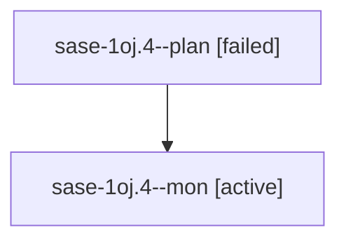

# Session: sase-1oj.4

[Agent Hoods](../README.md) / [bbugyi200](../users/bbugyi200/README.md) / [apollo](../users/bbugyi200/machines/apollo/README.md) / [sase-1oj](../users/bbugyi200/machines/apollo/hoods/sase-1oj/README.md) / sase-1oj.4

Owner: `bbugyi200.apollo` · Hood: `sase-1oj` · Members: 2 · Bead: [sase-1oj.4](https://github.com/sase-org/sase--beads/blob/main/pages/sase-1oj/sase-1oj.4.md)

## Lineage

The diagram is an optional enhancement; the ordered table below contains the same lineage in accessible text.

| Role | Agent | State | Model / provider | Timing | Commits | Prompt | Chat |
|---|---|---|---|---|---:|---|---|
| plan | sase-1oj.4--plan | failed | grok-4.6 / grok | 2026-10-26T22:10:03.181924+00:00 → 2026-10-27T02:16:32.536249+00:00 | [1](../agents/bbugyi200.apollo.sase-1oj.4--plan/README.md#commits) | [Prompt](../agents/bbugyi200.apollo.sase-1oj.4--plan/prompt.md) | [Chat](../agents/bbugyi200.apollo.sase-1oj.4--plan/chat.md) |
| mon | sase-1oj.4--mon | active | grok-4.6 / grok | 2026-10-27T02:15:39.732979+00:00 | 0 | — | — |

## Commits

| Role | Repo | Commit | Subject | Committed |
|---|---|---|---|---|
| plan | sase | [`e7d9f7a`](https://github.com/sase-org/sase/commit/e7d9f7a479664f412422ce40c0e679d29e5db41c) | feat(runner-slots): adopt pruned capacity scan | 2026-10-26 22:05:57 EDT |

## Neighbors

| Agent | Relation | State |
|---|---|---|
| [sase-1oj.1](../agents/bbugyi200.apollo.sase-1oj.1/README.md) | sase-1oj hood | completed |
| [sase-1oj.2](../agents/bbugyi200.apollo.sase-1oj.2/README.md) | sase-1oj hood | completed |
| [sase-1oj.3](../agents/bbugyi200.apollo.sase-1oj.3/README.md) | sase-1oj hood | completed |
| [sase-1oj.5](bbugyi200.apollo.sase-1oj.5.md) (session · 5) | sase-1oj hood | completed 3, failed 2 |
| [sase-1oj.6](../agents/bbugyi200.apollo.sase-1oj.6/README.md) | sase-1oj hood | waiting |
| [sase-1oj.land](../agents/bbugyi200.apollo.sase-1oj.land/README.md) | sase-1oj hood | waiting |
