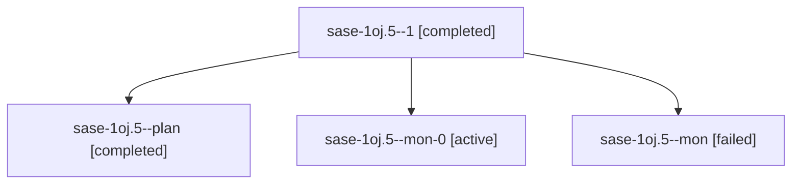

# Session: sase-1oj.5

[Agent Hoods](../README.md) / [bbugyi200](../users/bbugyi200/README.md) / [apollo](../users/bbugyi200/machines/apollo/README.md) / [sase-1oj](../users/bbugyi200/machines/apollo/hoods/sase-1oj/README.md) / sase-1oj.5

Owner: `bbugyi200.apollo` · Hood: `sase-1oj` · Members: 4 · Bead: [sase-1oj.5](https://github.com/sase-org/sase--beads/blob/main/pages/sase-1oj/sase-1oj.5.md)

## Lineage

The diagram is an optional enhancement; the ordered table below contains the same lineage in accessible text.

| Role | Agent | State | Model / provider | Timing | Commits | Prompt | Chat |
|---|---|---|---|---|---:|---|---|
| 1 | sase-1oj.5--1 | completed | grok-4.6 / grok | 2026-10-26T22:20:56.497145+00:00 → 2026-10-26T22:31:19.878809+00:00 | 0 | [Prompt](../agents/bbugyi200.apollo.sase-1oj.5--1/prompt.md) | [Chat](../agents/bbugyi200.apollo.sase-1oj.5--1/chat.md) |
| plan | sase-1oj.5--plan | completed | grok-4.6 / grok | 2026-10-26T20:08:53.745704+00:00 → 2026-10-26T21:21:48.341804+00:00 | 0 | [Prompt](../agents/bbugyi200.apollo.sase-1oj.5--plan/prompt.md) | [Chat](../agents/bbugyi200.apollo.sase-1oj.5--plan/chat.md) |
| mon-0 | sase-1oj.5--mon-0 | active | grok-4.6 / grok | 2026-10-26T22:29:26.428854+00:00 | 0 | — | — |
| mon | sase-1oj.5--mon | failed | grok-4.6 / grok | 2026-10-26T21:19:17.589924+00:00 → 2026-10-26T22:20:38.754333+00:00 | 0 | — | [Chat](../agents/bbugyi200.apollo.sase-1oj.5--mon/chat.md) |

## Neighbors

| Agent | Relation | State |
|---|---|---|
| [sase-1oj.1](../agents/bbugyi200.apollo.sase-1oj.1/README.md) | sase-1oj hood | completed |
| [sase-1oj.2](../agents/bbugyi200.apollo.sase-1oj.2/README.md) | sase-1oj hood | completed |
| [sase-1oj.3](../agents/bbugyi200.apollo.sase-1oj.3/README.md) | sase-1oj hood | active |
| [sase-1oj.4](../agents/bbugyi200.apollo.sase-1oj.4/README.md) | sase-1oj hood | active |
| [sase-1oj.6](../agents/bbugyi200.apollo.sase-1oj.6/README.md) | sase-1oj hood | waiting |
| [sase-1oj.land](../agents/bbugyi200.apollo.sase-1oj.land/README.md) | sase-1oj hood | waiting |
