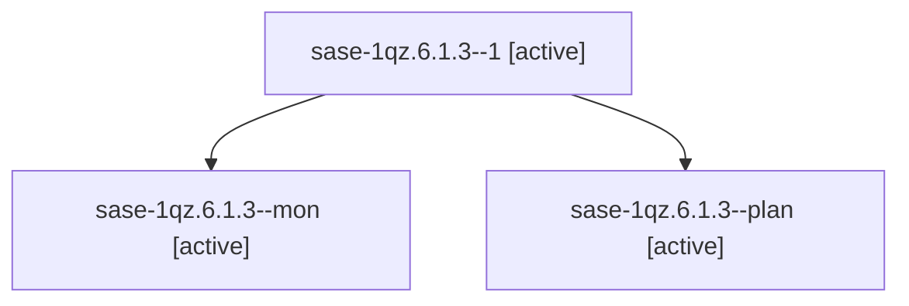

# Session: sase-1qz.6.1.3

[Agent Hoods](../README.md) / [bbugyi200](../users/bbugyi200/README.md) / [apollo](../users/bbugyi200/machines/apollo/README.md) / [sase-1qz](../users/bbugyi200/machines/apollo/hoods/sase-1qz/README.md) / sase-1qz.6.1.3

Owner: `bbugyi200.apollo` · Hood: `sase-1qz` · Members: 3 · Bead: [sase-1qz.6.1.3](https://github.com/sase-org/sase--beads/blob/main/pages/sase-1qz/sase-1qz.6.1.3.md)

## Lineage

The diagram is an optional enhancement; the ordered table below contains the same lineage in accessible text.

| Role | Agent | State | Model / provider | Timing | Commits | Prompt | Chat |
|---|---|---|---|---|---:|---|---|
| 1 | sase-1qz.6.1.3--1 | active | muse-spark-1.3-contributor / muse | 2026-11-03T22:03:42.158661+00:00 | [1](../agents/bbugyi200.apollo.sase-1qz.6.1.3--1/README.md#commits) | [Prompt](../agents/bbugyi200.apollo.sase-1qz.6.1.3--1/prompt.md) | — |
| mon | sase-1qz.6.1.3--mon | active | muse-spark-1.3-contributor / muse | 2026-11-03T19:44:18.680905+00:00 | 0 | — | — |
| plan | sase-1qz.6.1.3--plan | active | muse-spark-1.3-contributor / muse | 2026-11-03T18:10:19.105367+00:00 | 0 | [Prompt](../agents/bbugyi200.apollo.sase-1qz.6.1.3--plan/prompt.md) | [Chat](../agents/bbugyi200.apollo.sase-1qz.6.1.3--plan/chat.md) |

## Commits

| Role | Repo | Commit | Subject | Committed |
|---|---|---|---|---|
| 1 | sase | [`09bd42e`](https://github.com/sase-org/sase/commit/09bd42e622e7b63823376c23844b9d37a21e2c2b) | feat(agent-hijack): same-workspace recovery successor with mandatory inheritance | 2026-11-03 17:12:38 EST |

## Neighbors

| Agent | Relation | State |
|---|---|---|
| [sase-1qz.6](bbugyi200.apollo.sase-1qz.6.md) (session · 3) | ancestor | active 3 |
| [sase-1qz.6.1.1](../agents/bbugyi200.apollo.sase-1qz.6.1.1/README.md) | sase-1qz.6.1 hood | active |
| [sase-1qz.6.1.2](../agents/bbugyi200.apollo.sase-1qz.6.1.2/README.md) | sase-1qz.6.1 hood | active |
| [sase-1qz.6.1.4](../agents/bbugyi200.apollo.sase-1qz.6.1.4/README.md) | sase-1qz.6.1 hood | active |
| [sase-1qz.6.1.5](../agents/bbugyi200.apollo.sase-1qz.6.1.5/README.md) | sase-1qz.6.1 hood | active |
| [sase-1qz.6.1.6](../agents/bbugyi200.apollo.sase-1qz.6.1.6/README.md) | sase-1qz.6.1 hood | active |
| [sase-1qz.6.1.7](../agents/bbugyi200.apollo.sase-1qz.6.1.7/README.md) | sase-1qz.6.1 hood | active |
| [sase-1qz.6.1.land](../agents/bbugyi200.apollo.sase-1qz.6.1.land/README.md) | sase-1qz.6.1 hood | active |
| [sase-1qz.1](../agents/bbugyi200.apollo.sase-1qz.1/README.md) | sase-1qz hood | active |
| [sase-1qz.10](../agents/bbugyi200.apollo.sase-1qz.10/README.md) | sase-1qz hood | active |
| [sase-1qz.11](../agents/bbugyi200.apollo.sase-1qz.11/README.md) | sase-1qz hood | active |
| [sase-1qz.2](bbugyi200.apollo.sase-1qz.2.md) (session · 7) | sase-1qz hood | active 7 |
| [sase-1qz.3](bbugyi200.apollo.sase-1qz.3.md) (session · 5) | sase-1qz hood | active 5 |
| [sase-1qz.4](bbugyi200.apollo.sase-1qz.4.md) (session · 5) | sase-1qz hood | active 5 |
| [sase-1qz.5](../agents/bbugyi200.apollo.sase-1qz.5/README.md) | sase-1qz hood | active |
| [sase-1qz.7](../agents/bbugyi200.apollo.sase-1qz.7/README.md) | sase-1qz hood | active |
| [sase-1qz.8](bbugyi200.apollo.sase-1qz.8.md) (session · 11) | sase-1qz hood | active 11 |
| [sase-1qz.9](../agents/bbugyi200.apollo.sase-1qz.9/README.md) | sase-1qz hood | active |
| [sase-1qz.land](../agents/bbugyi200.apollo.sase-1qz.land/README.md) | sase-1qz hood | active |
