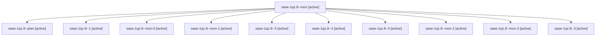

# Session: sase-1qz.8

[Agent Hoods](../README.md) / [bbugyi200](../users/bbugyi200/README.md) / [apollo](../users/bbugyi200/machines/apollo/README.md) / [sase-1qz](../users/bbugyi200/machines/apollo/hoods/sase-1qz/README.md) / sase-1qz.8

Owner: `bbugyi200.apollo` · Hood: `sase-1qz` · Members: 11 · Bead: [sase-1qz.8](https://github.com/sase-org/sase--beads/blob/main/pages/sase-1qz/sase-1qz.8.md)

## Lineage

The diagram is an optional enhancement; the ordered table below contains the same lineage in accessible text.

| Role | Agent | State | Model / provider | Timing | Commits | Prompt | Chat |
|---|---|---|---|---|---:|---|---|
| mon | sase-1qz.8--mon | active | gpt-6-luna / codex | 2026-11-03T11:58:09.857995+00:00 | 0 | — | — |
| plan | sase-1qz.8--plan | active | gpt-6-luna / codex | 2026-11-03T11:37:37.469195+00:00 | 0 | [Prompt](../agents/bbugyi200.apollo.sase-1qz.8--plan/prompt.md) | [Chat](../agents/bbugyi200.apollo.sase-1qz.8--plan/chat.md) |
| 1 | sase-1qz.8--1 | active | gpt-6-luna / codex | 2026-11-03T12:05:41.759181+00:00 | 0 | [Prompt](../agents/bbugyi200.apollo.sase-1qz.8--1/prompt.md) | [Chat](../agents/bbugyi200.apollo.sase-1qz.8--1/chat.md) |
| mon-0 | sase-1qz.8--mon-0 | active | gpt-6-luna / codex | 2026-11-03T12:13:16.998326+00:00 | 0 | — | — |
| mon-1 | sase-1qz.8--mon-1 | active | gpt-6-luna / codex | 2026-11-03T12:43:53.379004+00:00 | 0 | — | — |
| 5 | sase-1qz.8--5 | active | gpt-6-luna / codex | 2026-11-03T15:55:19.783869+00:00 | [1](../agents/bbugyi200.apollo.sase-1qz.8--5/README.md#commits) | [Prompt](../agents/bbugyi200.apollo.sase-1qz.8--5/prompt.md) | — |
| 2 | sase-1qz.8--2 | active | gpt-6-luna / codex | 2026-11-03T12:28:11.866623+00:00 | 0 | [Prompt](../agents/bbugyi200.apollo.sase-1qz.8--2/prompt.md) | [Chat](../agents/bbugyi200.apollo.sase-1qz.8--2/chat.md) |
| 4 | sase-1qz.8--4 | active | gpt-6-luna / codex | 2026-11-03T15:00:13.960266+00:00 | 0 | [Prompt](../agents/bbugyi200.apollo.sase-1qz.8--4/prompt.md) | [Chat](../agents/bbugyi200.apollo.sase-1qz.8--4/chat.md) |
| mon-2 | sase-1qz.8--mon-2 | active | gpt-6-luna / codex | 2026-11-03T13:51:24.987550+00:00 | 0 | — | — |
| mon-3 | sase-1qz.8--mon-3 | active | gpt-6-luna / codex | 2026-11-03T15:48:18.200349+00:00 | 0 | — | — |
| 3 | sase-1qz.8--3 | active | gpt-6-luna / codex | 2026-11-03T13:46:32.440552+00:00 | 0 | [Prompt](../agents/bbugyi200.apollo.sase-1qz.8--3/prompt.md) | [Chat](../agents/bbugyi200.apollo.sase-1qz.8--3/chat.md) |

## Commits

| Role | Repo | Commit | Subject | Committed |
|---|---|---|---|---|
| 5 | sase | [`81808e9`](https://github.com/sase-org/sase/commit/81808e9ba0ad955a6a3562cd4a21b53b24bf542a) | feat(ace): add Agent Hijack controls to Agents tab | 2026-11-03 11:07:38 EST |

## Neighbors

| Agent | Relation | State |
|---|---|---|
| [sase-1qz.1](../agents/bbugyi200.apollo.sase-1qz.1/README.md) | sase-1qz hood | active |
| [sase-1qz.10](../agents/bbugyi200.apollo.sase-1qz.10/README.md) | sase-1qz hood | active |
| [sase-1qz.11](../agents/bbugyi200.apollo.sase-1qz.11/README.md) | sase-1qz hood | active |
| [sase-1qz.2](bbugyi200.apollo.sase-1qz.2.md) (session · 7) | sase-1qz hood | active 7 |
| [sase-1qz.3](bbugyi200.apollo.sase-1qz.3.md) (session · 5) | sase-1qz hood | active 5 |
| [sase-1qz.4](bbugyi200.apollo.sase-1qz.4.md) (session · 5) | sase-1qz hood | active 5 |
| [sase-1qz.5](../agents/bbugyi200.apollo.sase-1qz.5/README.md) | sase-1qz hood | active |
| [sase-1qz.6](bbugyi200.apollo.sase-1qz.6.md) (session · 3) | sase-1qz hood | active 3 |
| [sase-1qz.6.1.1](../agents/bbugyi200.apollo.sase-1qz.6.1.1/README.md) | sase-1qz hood | active |
| [sase-1qz.6.1.2](../agents/bbugyi200.apollo.sase-1qz.6.1.2/README.md) | sase-1qz hood | active |
| [sase-1qz.6.1.3](bbugyi200.apollo.sase-1qz.6.1.3.md) (session · 3) | sase-1qz hood | active 3 |
| [sase-1qz.6.1.4](../agents/bbugyi200.apollo.sase-1qz.6.1.4/README.md) | sase-1qz hood | active |
| [sase-1qz.6.1.5](../agents/bbugyi200.apollo.sase-1qz.6.1.5/README.md) | sase-1qz hood | active |
| [sase-1qz.6.1.6](../agents/bbugyi200.apollo.sase-1qz.6.1.6/README.md) | sase-1qz hood | active |
| [sase-1qz.6.1.7](../agents/bbugyi200.apollo.sase-1qz.6.1.7/README.md) | sase-1qz hood | active |
| [sase-1qz.6.1.land](../agents/bbugyi200.apollo.sase-1qz.6.1.land/README.md) | sase-1qz hood | active |
| [sase-1qz.7](../agents/bbugyi200.apollo.sase-1qz.7/README.md) | sase-1qz hood | active |
| [sase-1qz.9](../agents/bbugyi200.apollo.sase-1qz.9/README.md) | sase-1qz hood | active |
| [sase-1qz.land](../agents/bbugyi200.apollo.sase-1qz.land/README.md) | sase-1qz hood | active |
