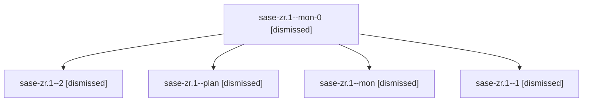

# Session: sase-zr.1

[Agent Hoods](../README.md) / [bbugyi200](../users/bbugyi200/README.md) / [apollo](../users/bbugyi200/machines/apollo/README.md) / [sase-zr](../users/bbugyi200/machines/apollo/hoods/sase-zr/README.md) / sase-zr.1

Owner: `bbugyi200.apollo` · Hood: `sase-zr` · Members: 5 · Bead: [sase-zr.1](https://github.com/sase-org/sase--beads/blob/main/pages/sase-zr/sase-zr.1.md)

## Lineage

The diagram is an optional enhancement; the ordered table below contains the same lineage in accessible text.

| Role | Agent | State | Model / provider | Timing | Commits | Prompt | Chat |
|---|---|---|---|---|---:|---|---|
| mon-0 | sase-zr.1--mon-0 | dismissed | sonnet / claude | 2026-09-13T18:42:36.274524 → 2026-09-13T19:07:38.746119 | 0 | — | [Chat](../agents/bbugyi200.apollo.sase-zr.1--mon-0/chat.md) |
| 2 | sase-zr.1--2 | dismissed | sonnet / claude | 2026-09-13T19:07:57.297806 → 2026-09-13T19:21:33.644379 | 0 | [Prompt](../agents/bbugyi200.apollo.sase-zr.1--2/prompt.md) | [Chat](../agents/bbugyi200.apollo.sase-zr.1--2/chat.md) |
| plan | sase-zr.1--plan | dismissed | sonnet / claude | 2026-09-13T17:13:00.350340 → 2026-09-13T18:21:13.843077 | [1](../agents/bbugyi200.apollo.sase-zr.1--plan/README.md#commits) | [Prompt](../agents/bbugyi200.apollo.sase-zr.1--plan/prompt.md) | [Chat](../agents/bbugyi200.apollo.sase-zr.1--plan/chat.md) |
| mon | sase-zr.1--mon | dismissed | sonnet / claude | 2026-09-13T18:20:55.585179 → 2026-09-13T18:40:57.869200 | 0 | — | [Chat](../agents/bbugyi200.apollo.sase-zr.1--mon/chat.md) |
| 1 | sase-zr.1--1 | dismissed | sonnet / claude | 2026-09-13T18:41:11.706132 → 2026-09-13T18:42:52.478710 | 0 | [Prompt](../agents/bbugyi200.apollo.sase-zr.1--1/prompt.md) | [Chat](../agents/bbugyi200.apollo.sase-zr.1--1/chat.md) |

## Commits

| Role | Repo | Commit | Subject | Committed |
|---|---|---|---|---|
| plan | — | `93f3d58` | feat(gate-shell): add indexed gate-shell-by-gate-id lookup with telemetry | 2026-09-13 19:12:59 EDT |

## Neighbors

| Agent | Relation | State |
|---|---|---|
| [sase-zr.2](bbugyi200.apollo.sase-zr.2.md) (session · 3) | sase-zr hood | dismissed 3 |
| [sase-zr.2](../agents/bbugyi200.apollo.sase-zr.2/README.md) | sase-zr hood | completed |
| [sase-zr.3](../agents/bbugyi200.apollo.sase-zr.3/README.md) | sase-zr hood | dismissed |
| [sase-zr.4](../agents/bbugyi200.apollo.sase-zr.4/README.md) | sase-zr hood | dismissed |
| [sase-zr.5](bbugyi200.apollo.sase-zr.5.md) (session · 3) | sase-zr hood | dismissed 1, failed 2 |
| [sase-zr.6](bbugyi200.apollo.sase-zr.6.md) (session · 6) | sase-zr hood | dismissed 6 |
| [sase-zr.7.1](bbugyi200.apollo.sase-zr.7.1.md) (session · 4) | sase-zr hood | active 1, failed 3 |
| [sase-zr.7.1.1.1](../agents/bbugyi200.apollo.sase-zr.7.1.1.1/README.md) | sase-zr hood | completed |
| [sase-zr.7.1.1.2](../agents/bbugyi200.apollo.sase-zr.7.1.1.2/README.md) | sase-zr hood | completed |
| [sase-zr.7.1.1.3](../agents/bbugyi200.apollo.sase-zr.7.1.1.3/README.md) | sase-zr hood | completed |
| [sase-zr.7.1.1.4](../agents/bbugyi200.apollo.sase-zr.7.1.1.4/README.md) | sase-zr hood | completed |
| [sase-zr.7.1.1.5.1](../agents/bbugyi200.apollo.sase-zr.7.1.1.5.1/README.md) | sase-zr hood | completed |
| [sase-zr.7.1.1.5.2](../agents/bbugyi200.apollo.sase-zr.7.1.1.5.2/README.md) | sase-zr hood | completed |
| [sase-zr.7.1.1.5.3](../agents/bbugyi200.apollo.sase-zr.7.1.1.5.3/README.md) | sase-zr hood | completed |
| [sase-zr.7.1.1.5.4.1](../agents/bbugyi200.apollo.sase-zr.7.1.1.5.4.1/README.md) | sase-zr hood | completed |
| [sase-zr.7.1.1.5.4.2](bbugyi200.apollo.sase-zr.7.1.1.5.4.2.md) (session · 21) | sase-zr hood | completed 11, failed 10 |
| [sase-zr.7.1.1.5.4.land](../agents/bbugyi200.apollo.sase-zr.7.1.1.5.4.land/README.md) | sase-zr hood | completed |
| [sase-zr.7.1.1.5.land](bbugyi200.apollo.sase-zr.7.1.1.5.land.md) (session · 3) | sase-zr hood | failed 3 |
| [sase-zr.7.1.1.land](bbugyi200.apollo.sase-zr.7.1.1.land.md) (session · 3) | sase-zr hood | failed 3 |
| [sase-zr.7.2](bbugyi200.apollo.sase-zr.7.2.md) (session · 3) | sase-zr hood | completed 2, failed 1 |
| [sase-zr.7.3](../agents/bbugyi200.apollo.sase-zr.7.3/README.md) | sase-zr hood | completed |
| [sase-zr.7.4](../agents/bbugyi200.apollo.sase-zr.7.4/README.md) | sase-zr hood | completed |
| [sase-zr.7.5](../agents/bbugyi200.apollo.sase-zr.7.5/README.md) | sase-zr hood | completed |
| [sase-zr.7.land](../agents/bbugyi200.apollo.sase-zr.7.land/README.md) | sase-zr hood | dismissed |
| [sase-zr.land](../agents/bbugyi200.apollo.sase-zr.land/README.md) | sase-zr hood | dismissed |
