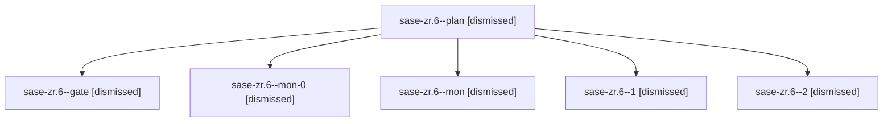

# Session: sase-zr.6

[Agent Hoods](../README.md) / [bbugyi200](../users/bbugyi200/README.md) / [apollo](../users/bbugyi200/machines/apollo/README.md) / [sase-zr](../users/bbugyi200/machines/apollo/hoods/sase-zr/README.md) / sase-zr.6

Owner: `bbugyi200.apollo` · Hood: `sase-zr` · Members: 6 · Bead: [sase-zr.6](https://github.com/sase-org/sase--beads/blob/main/pages/sase-zr/sase-zr.6.md)

## Lineage

The diagram is an optional enhancement; the ordered table below contains the same lineage in accessible text.

| Role | Agent | State | Model / provider | Timing | Commits | Prompt | Chat |
|---|---|---|---|---|---:|---|---|
| plan | sase-zr.6--plan | dismissed | gpt-5.5 / codex | 2026-09-14T14:19:42.947671 → 2026-09-14T15:35:45.916475 | 0 | [Prompt](../agents/bbugyi200.apollo.sase-zr.6--plan/prompt.md) | [Chat](../agents/bbugyi200.apollo.sase-zr.6--plan/chat.md) |
| gate | sase-zr.6--gate | dismissed | gpt-5.5 / codex | 2026-09-14T14:48:27.437736 → 2026-09-14T15:36:02 | 0 | — | [Chat](../agents/bbugyi200.apollo.sase-zr.6--gate/chat.md) |
| mon-0 | sase-zr.6--mon-0 | dismissed | sonnet / claude | 2026-09-14T17:36:56.712086 → 2026-09-14T19:23:02.013127 | 0 | — | [Chat](../agents/bbugyi200.apollo.sase-zr.6--mon-0/chat.md) |
| mon | sase-zr.6--mon | dismissed | gpt-5.5 / codex | 2026-09-14T15:35:26.239902 → 2026-09-14T17:35:28.732986 | 0 | — | [Chat](../agents/bbugyi200.apollo.sase-zr.6--mon/chat.md) |
| 1 | sase-zr.6--1 | dismissed | sonnet / claude | 2026-09-14T17:35:45.615247 → 2026-09-14T17:37:17.481791 | 0 | [Prompt](../agents/bbugyi200.apollo.sase-zr.6--1/prompt.md) | [Chat](../agents/bbugyi200.apollo.sase-zr.6--1/chat.md) |
| 2 | sase-zr.6--2 | dismissed | sonnet / claude | 2026-09-14T19:23:12.737243 → 2026-09-14T19:43:43.546648 | [1](../agents/bbugyi200.apollo.sase-zr.6--2/README.md#commits) | [Prompt](../agents/bbugyi200.apollo.sase-zr.6--2/prompt.md) | [Chat](../agents/bbugyi200.apollo.sase-zr.6--2/chat.md) |

## Commits

| Role | Repo | Commit | Subject | Committed |
|---|---|---|---|---|
| 2 | — | `7f7700d` | docs(notifications): document gate decision receipts, rollout order, and latency probes | 2026-09-14 19:28:12 EDT |

## Neighbors

| Agent | Relation | State |
|---|---|---|
| [sase-zr.1](bbugyi200.apollo.sase-zr.1.md) (session · 5) | sase-zr hood | dismissed 5 |
| [sase-zr.1](../agents/bbugyi200.apollo.sase-zr.1/README.md) | sase-zr hood | completed |
| [sase-zr.2](bbugyi200.apollo.sase-zr.2.md) (session · 3) | sase-zr hood | dismissed 3 |
| [sase-zr.2](../agents/bbugyi200.apollo.sase-zr.2/README.md) | sase-zr hood | completed |
| [sase-zr.3](../agents/bbugyi200.apollo.sase-zr.3/README.md) | sase-zr hood | dismissed |
| [sase-zr.4](../agents/bbugyi200.apollo.sase-zr.4/README.md) | sase-zr hood | dismissed |
| [sase-zr.5](bbugyi200.apollo.sase-zr.5.md) (session · 3) | sase-zr hood | dismissed 1, failed 2 |
| [sase-zr.7.1](bbugyi200.apollo.sase-zr.7.1.md) (session · 4) | sase-zr hood | active 1, failed 3 |
| [sase-zr.7.1.1.1](../agents/bbugyi200.apollo.sase-zr.7.1.1.1/README.md) | sase-zr hood | completed |
| [sase-zr.7.1.1.2](../agents/bbugyi200.apollo.sase-zr.7.1.1.2/README.md) | sase-zr hood | completed |
| [sase-zr.7.1.1.3](../agents/bbugyi200.apollo.sase-zr.7.1.1.3/README.md) | sase-zr hood | completed |
| [sase-zr.7.1.1.4](../agents/bbugyi200.apollo.sase-zr.7.1.1.4/README.md) | sase-zr hood | completed |
| [sase-zr.7.1.1.5.1](../agents/bbugyi200.apollo.sase-zr.7.1.1.5.1/README.md) | sase-zr hood | completed |
| [sase-zr.7.1.1.5.2](../agents/bbugyi200.apollo.sase-zr.7.1.1.5.2/README.md) | sase-zr hood | completed |
| [sase-zr.7.1.1.5.3](../agents/bbugyi200.apollo.sase-zr.7.1.1.5.3/README.md) | sase-zr hood | completed |
| [sase-zr.7.1.1.5.4.1](../agents/bbugyi200.apollo.sase-zr.7.1.1.5.4.1/README.md) | sase-zr hood | completed |
| [sase-zr.7.1.1.5.4.2](bbugyi200.apollo.sase-zr.7.1.1.5.4.2.md) (session · 21) | sase-zr hood | completed 11, failed 10 |
| [sase-zr.7.1.1.5.4.land](../agents/bbugyi200.apollo.sase-zr.7.1.1.5.4.land/README.md) | sase-zr hood | completed |
| [sase-zr.7.1.1.5.land](bbugyi200.apollo.sase-zr.7.1.1.5.land.md) (session · 3) | sase-zr hood | failed 3 |
| [sase-zr.7.1.1.land](bbugyi200.apollo.sase-zr.7.1.1.land.md) (session · 3) | sase-zr hood | failed 3 |
| [sase-zr.7.2](bbugyi200.apollo.sase-zr.7.2.md) (session · 3) | sase-zr hood | completed 2, failed 1 |
| [sase-zr.7.3](../agents/bbugyi200.apollo.sase-zr.7.3/README.md) | sase-zr hood | completed |
| [sase-zr.7.4](../agents/bbugyi200.apollo.sase-zr.7.4/README.md) | sase-zr hood | completed |
| [sase-zr.7.5](../agents/bbugyi200.apollo.sase-zr.7.5/README.md) | sase-zr hood | completed |
| [sase-zr.7.land](../agents/bbugyi200.apollo.sase-zr.7.land/README.md) | sase-zr hood | dismissed |
| [sase-zr.land](../agents/bbugyi200.apollo.sase-zr.land/README.md) | sase-zr hood | dismissed |
