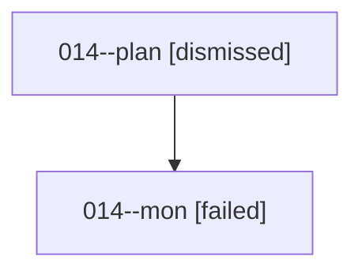

# Session: 014

[Agent Hoods](../README.md) / [bbugyi200](../users/bbugyi200/README.md) / [athena](../users/bbugyi200/machines/athena/README.md) / [014](../users/bbugyi200/machines/athena/hoods/014/README.md) / 014

Owner: `bbugyi200.athena` · Hood: `014` · Members: 2

## Lineage

The diagram is an optional enhancement; the ordered table below contains the same lineage in accessible text.

| Role | Agent | State | Model / provider | Timing | Commits | Prompt | Chat |
|---|---|---|---|---|---:|---|---|
| plan | 014--plan | dismissed | opus / claude | 2026-08-14T10:38:47.585475 → 2026-08-14T10:49:07.256788 | 0 | [Prompt](../agents/bbugyi200.athena.014--plan/prompt.md) | [Chat](../agents/bbugyi200.athena.014--plan/chat.md) |
| mon | 014--mon | failed | opus / claude | 2026-08-14T14:49:14.045714+00:00 | 0 | — | [Chat](../agents/bbugyi200.athena.014--mon/chat.md) |

## Commits

| Role | Repo | Commit | Subject | Committed |
|---|---|---|---|---|
| — | — | `e2fcc1d` | chore: Add SDD prompt and plan for fork\_implies\_wait | 2026-06-19 09:50:33 EDT |
| — | — | `e64a9eb` | feat(fork): make \`#fork:\<name\>\` imply \`%w:\<name\>\` | 2026-06-19 10:11:37 EDT |

## Neighbors

| Agent | Relation | State |
|---|---|---|
| [014.f1](../agents/bbugyi200.athena.014.f1/README.md) | descendant | completed |
