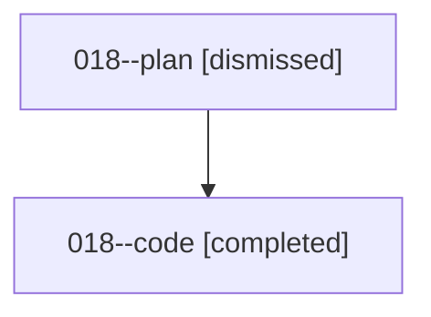

# Session: 018

[Agent Hoods](../README.md) / [bbugyi200](../users/bbugyi200/README.md) / [athena](../users/bbugyi200/machines/athena/README.md) / [018](../users/bbugyi200/machines/athena/hoods/018/README.md) / 018

Owner: `bbugyi200.athena` · Hood: `018` · Members: 2

## Lineage

The diagram is an optional enhancement; the ordered table below contains the same lineage in accessible text.

| Role | Agent | State | Model / provider | Timing | Commits | Prompt | Chat |
|---|---|---|---|---|---:|---|---|
| plan | 018--plan | dismissed | opus / claude | 2026-08-14T11:17:16.861702 → 2026-08-14T11:48:25.891980 | 0 | [Prompt](../agents/bbugyi200.athena.018--plan/prompt.md) | [Chat](../agents/bbugyi200.athena.018--plan/chat.md) |
| code | 018--code | completed | gpt-5.5 / codex | 2026-08-14T15:26:21.901240+00:00 | [1](../agents/bbugyi200.athena.018--code/README.md#commits) | — | [Chat](../agents/bbugyi200.athena.018--code/chat.md) |

## Commits

| Role | Repo | Commit | Subject | Committed |
|---|---|---|---|---|
| — | — | `7bc665b` | chore: Add SDD prompt and plan for init\_onboarding\_agents | 2026-06-19 10:42:52 EDT |
| — | — | `8062e6f` | feat(init): repair AGENTS.md via onboarding title fallback | 2026-06-19 11:10:49 EDT |
| code | — | `08a69e3` | fix(monitor): keep follow-up prompt bodies literal | 2026-08-14 11:46:27 EDT |

## Neighbors

| Agent | Relation | State |
|---|---|---|
| [018.f1](../agents/bbugyi200.athena.018.f1/README.md) | descendant | completed |
