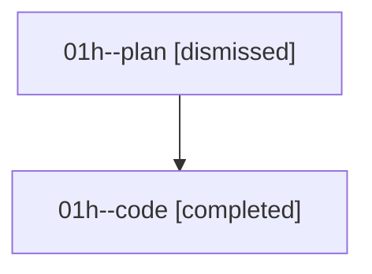

# Session: 01h

[Agent Hoods](../README.md) / [bbugyi200](../users/bbugyi200/README.md) / [athena](../users/bbugyi200/machines/athena/README.md) / [01h](../users/bbugyi200/machines/athena/hoods/01h/README.md) / 01h

Owner: `bbugyi200.athena` · Hood: `01h` · Members: 2

## Lineage

The diagram is an optional enhancement; the ordered table below contains the same lineage in accessible text.

| Role | Agent | State | Model / provider | Timing | Commits | Prompt | Chat |
|---|---|---|---|---|---:|---|---|
| plan | 01h--plan | dismissed | gpt-5.6-sol / codex | 2026-08-14T13:18:07.859590 → 2026-08-14T13:27:35.606656 | 0 | [Prompt](../agents/bbugyi200.athena.01h--plan/prompt.md) | [Chat](../agents/bbugyi200.athena.01h--plan/chat.md) |
| code | 01h--code | completed | sonnet / claude | 2026-08-14T17:21:17.096966+00:00 | [1](../agents/bbugyi200.athena.01h--code/README.md#commits) | — | [Chat](../agents/bbugyi200.athena.01h--code/chat.md) |

## Commits

| Role | Repo | Commit | Subject | Committed |
|---|---|---|---|---|
| — | — | `52c5ab2` | chore: Add SDD prompt and plan for xprompts\_enabled\_skips\_embedded\_validation | 2026-06-19 14:39:47 EDT |
| — | — | `86f89d4` | fix: ignore embedded prompts in disabled regions | 2026-06-19 14:47:20 EDT |
| code | — | `ecb5c93` | fix(ace): confirm selector builder on Enter when list is focused | 2026-08-14 13:27:05 EDT |
