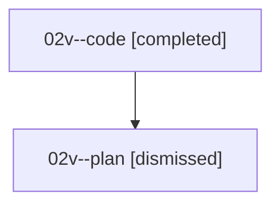

# Session: 02v

[Agent Hoods](../README.md) / [bbugyi200](../users/bbugyi200/README.md) / [athena](../users/bbugyi200/machines/athena/README.md) / [02v](../users/bbugyi200/machines/athena/hoods/02v/README.md) / 02v

Owner: `bbugyi200.athena` · Hood: `02v` · Members: 2

## Lineage

The diagram is an optional enhancement; the ordered table below contains the same lineage in accessible text.

| Role | Agent | State | Model / provider | Timing | Commits | Prompt | Chat |
|---|---|---|---|---|---:|---|---|
| code | 02v--code | completed | gpt-5.5 / codex | 2026-08-15T21:37:29.119994+00:00 | [1](../agents/bbugyi200.athena.02v--code/README.md#commits) | — | [Chat](../agents/bbugyi200.athena.02v--code/chat.md) |
| plan | 02v--plan | dismissed | gpt-5.6-sol / codex | 2026-08-15T17:02:29 | 0 | [Prompt](../agents/bbugyi200.athena.02v--plan/prompt.md) | [Chat](../agents/bbugyi200.athena.02v--plan/chat.md) |

## Commits

| Role | Repo | Commit | Subject | Committed |
|---|---|---|---|---|
| — | — | `702b82f` | chore: Add SDD prompt and plan for log\_panel\_g\_scroll | 2026-06-20 19:00:09 EDT |
| — | — | `de38910` | feat(tui): add g/G top-bottom scrolling to ACE Logs panel | 2026-06-20 19:07:06 EDT |
| code | — | `6f3e51a` | fix(bead): preserve active workers during relaunch | 2026-08-15 18:30:30 EDT |
