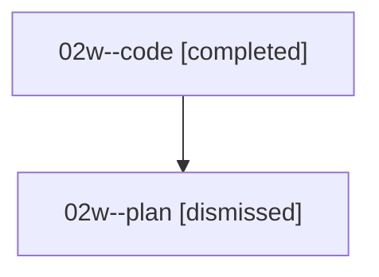

# Session: 02w

[Agent Hoods](../README.md) / [bbugyi200](../users/bbugyi200/README.md) / [athena](../users/bbugyi200/machines/athena/README.md) / [02w](../users/bbugyi200/machines/athena/hoods/02w/README.md) / 02w

Owner: `bbugyi200.athena` · Hood: `02w` · Members: 2

## Lineage

The diagram is an optional enhancement; the ordered table below contains the same lineage in accessible text.

| Role | Agent | State | Model / provider | Timing | Commits | Prompt | Chat |
|---|---|---|---|---|---:|---|---|
| code | 02w--code | completed | gpt-5.5 / codex | 2026-08-15T22:55:43.939380+00:00 | [1](../agents/bbugyi200.athena.02w--code/README.md#commits) | — | [Chat](../agents/bbugyi200.athena.02w--code/chat.md) |
| plan | 02w--plan | dismissed | gpt-5.6-sol / codex | 2026-08-15T18:48:29 | 0 | [Prompt](../agents/bbugyi200.athena.02w--plan/prompt.md) | [Chat](../agents/bbugyi200.athena.02w--plan/chat.md) |

## Commits

| Role | Repo | Commit | Subject | Committed |
|---|---|---|---|---|
| — | — | `089c49a` | chore: Add SDD prompt and plan for startup\_stopwatch\_escalation\_colors | 2026-06-21 08:13:53 EDT |
| — | — | `ec8c494` | feat(tui): escalate startup stopwatch colors | 2026-06-21 08:22:30 EDT |
| code | — | `75c670c` | feat(ace): add launch control threshold editing | 2026-08-15 19:49:25 EDT |

## Neighbors

| Agent | Relation | State |
|---|---|---|
| [02w.f0](bbugyi200.athena.02w.f0.md) (session · 2) | descendant | completed 1, dismissed 1 |
