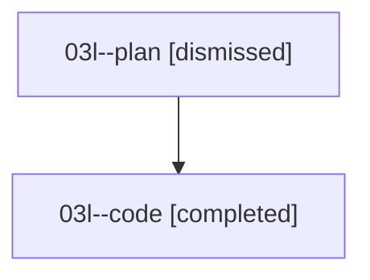

# Session: 03l

[Agent Hoods](../README.md) / [bbugyi200](../users/bbugyi200/README.md) / [athena](../users/bbugyi200/machines/athena/README.md) / [03l](../users/bbugyi200/machines/athena/hoods/03l/README.md) / 03l

Owner: `bbugyi200.athena` · Hood: `03l` · Members: 2

## Lineage

The diagram is an optional enhancement; the ordered table below contains the same lineage in accessible text.

| Role | Agent | State | Model / provider | Timing | Commits | Prompt | Chat |
|---|---|---|---|---|---:|---|---|
| plan | 03l--plan | dismissed | opus / claude | 2026-08-16T10:49:54 | 0 | [Prompt](../agents/bbugyi200.athena.03l--plan/prompt.md) | [Chat](../agents/bbugyi200.athena.03l--plan/chat.md) |
| code | 03l--code | completed | grok-4.6 / grok | 2026-08-16T15:01:54.238795+00:00 | [1](../agents/bbugyi200.athena.03l--code/README.md#commits) | — | [Chat](../agents/bbugyi200.athena.03l--code/chat.md) |

## Commits

| Role | Repo | Commit | Subject | Committed |
|---|---|---|---|---|
| code | — | `1d83e7a` | refactor: rename Agent Lane to Agent Node and add Sase Node | 2026-08-16 11:26:00 EDT |
