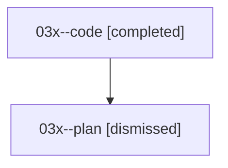

# Session: 03x

[Agent Hoods](../README.md) / [bbugyi200](../users/bbugyi200/README.md) / [athena](../users/bbugyi200/machines/athena/README.md) / [03x](../users/bbugyi200/machines/athena/hoods/03x/README.md) / 03x

Owner: `bbugyi200.athena` · Hood: `03x` · Members: 2

## Lineage

The diagram is an optional enhancement; the ordered table below contains the same lineage in accessible text.

| Role | Agent | State | Model / provider | Timing | Commits | Prompt | Chat |
|---|---|---|---|---|---:|---|---|
| code | 03x--code | completed | sonnet / claude | 2026-08-16T16:53:04.326541+00:00 | [1](../agents/bbugyi200.athena.03x--code/README.md#commits) | — | [Chat](../agents/bbugyi200.athena.03x--code/chat.md) |
| plan | 03x--plan | dismissed | opus / claude | 2026-08-16T12:35:30 | 0 | [Prompt](../agents/bbugyi200.athena.03x--plan/prompt.md) | [Chat](../agents/bbugyi200.athena.03x--plan/chat.md) |

## Commits

| Role | Repo | Commit | Subject | Committed |
|---|---|---|---|---|
| — | — | `353e536` | chore: Add SDD prompt and plan for rust\_clippy\_196\_fix | 2026-06-23 07:20:06 EDT |
| — | — | `ec78b05` | chore: Mark SDD plan done | 2026-06-23 08:38:26 EDT |
| code | — | `ce1ad41` | fix(ace): stop the file panel from losing the reader's scroll position | 2026-08-16 13:54:02 EDT |
