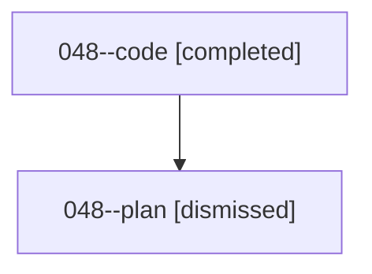

# Session: 048

[Agent Hoods](../README.md) / [bbugyi200](../users/bbugyi200/README.md) / [athena](../users/bbugyi200/machines/athena/README.md) / [048](../users/bbugyi200/machines/athena/hoods/048/README.md) / 048

Owner: `bbugyi200.athena` · Hood: `048` · Members: 2

## Lineage

The diagram is an optional enhancement; the ordered table below contains the same lineage in accessible text.

| Role | Agent | State | Model / provider | Timing | Commits | Prompt | Chat |
|---|---|---|---|---|---:|---|---|
| code | 048--code | completed | sonnet / claude | 2026-08-16T20:05:04.865383+00:00 | [1](../agents/bbugyi200.athena.048--code/README.md#commits) | — | [Chat](../agents/bbugyi200.athena.048--code/chat.md) |
| plan | 048--plan | dismissed | opus / claude | 2026-08-16T15:52:20 | 0 | [Prompt](../agents/bbugyi200.athena.048--plan/prompt.md) | [Chat](../agents/bbugyi200.athena.048--plan/chat.md) |

## Commits

| Role | Repo | Commit | Subject | Committed |
|---|---|---|---|---|
| — | — | `70d4214` | chore: Add SDD prompt and plan for zoom\_file\_reverse\_cycle | 2026-06-23 09:02:11 EDT |
| — | — | `229050d` | test(ace): cover zoom modal file cycling in both directions | 2026-06-23 09:18:51 EDT |
| code | — | `83e2cee` | feat(ace): unify monitor gear iconography across nodes and the top bar | 2026-08-16 17:15:13 EDT |
