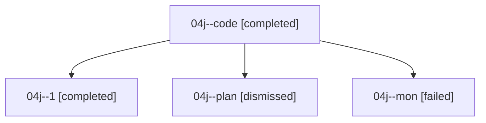

# Session: 04j

[Agent Hoods](../README.md) / [bbugyi200](../users/bbugyi200/README.md) / [athena](../users/bbugyi200/machines/athena/README.md) / [04j](../users/bbugyi200/machines/athena/hoods/04j/README.md) / 04j

Owner: `bbugyi200.athena` · Hood: `04j` · Members: 4

## Lineage

The diagram is an optional enhancement; the ordered table below contains the same lineage in accessible text.

| Role | Agent | State | Model / provider | Timing | Commits | Prompt | Chat |
|---|---|---|---|---|---:|---|---|
| code | 04j--code | completed | grok-4.6 / grok | 2026-08-17T11:33:12.857202+00:00 | 0 | — | [Chat](../agents/bbugyi200.athena.04j--code/chat.md) |
| 1 | 04j--1 | completed | grok-4.6 / grok | 2026-08-17T12:16:46.907082+00:00 | [1](../agents/bbugyi200.athena.04j--1/README.md#commits) | [Prompt](../agents/bbugyi200.athena.04j--1/prompt.md) | [Chat](../agents/bbugyi200.athena.04j--1/chat.md) |
| plan | 04j--plan | dismissed | opus / claude | 2026-08-17T07:14:01 | 0 | [Prompt](../agents/bbugyi200.athena.04j--plan/prompt.md) | [Chat](../agents/bbugyi200.athena.04j--plan/chat.md) |
| mon | 04j--mon | failed | grok-4.6 / grok | 2026-08-17T12:14:26.055205+00:00 | 0 | — | [Chat](../agents/bbugyi200.athena.04j--mon/chat.md) |

## Commits

| Role | Repo | Commit | Subject | Committed |
|---|---|---|---|---|
| — | — | `ee82c7c` | chore: Add SDD prompt and plan for linked\_repo\_deltas\_rust\_scan\_fix | 2026-06-23 12:46:59 EDT |
| — | — | `a152741` | fix(agent-scan): rebuild stale linked repo index rows | 2026-06-23 13:03:55 EDT |
| 1 | — | `442d871` | feat(ace-tui): restore grouping-cycle to o/O and move open-externally to E | 2026-08-17 08:23:07 EDT |

## Neighbors

| Agent | Relation | State |
|---|---|---|
| [04j.f1](../agents/bbugyi200.athena.04j.f1/README.md) | descendant | completed |
| [04j.f1.f1](../agents/bbugyi200.athena.04j.f1.f1/README.md) | descendant | completed |
| [04j.f1.f1.f1](../agents/bbugyi200.athena.04j.f1.f1.f1/README.md) | descendant | completed |
