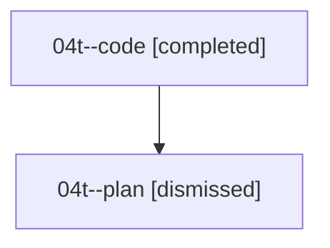

# Session: 04t

[Agent Hoods](../README.md) / [bbugyi200](../users/bbugyi200/README.md) / [athena](../users/bbugyi200/machines/athena/README.md) / [04t](../users/bbugyi200/machines/athena/hoods/04t/README.md) / 04t

Owner: `bbugyi200.athena` · Hood: `04t` · Members: 2

## Lineage

The diagram is an optional enhancement; the ordered table below contains the same lineage in accessible text.

| Role | Agent | State | Model / provider | Timing | Commits | Prompt | Chat |
|---|---|---|---|---|---:|---|---|
| code | 04t--code | completed | sonnet / claude | 2026-08-17T14:43:52.422214+00:00 | [1](../agents/bbugyi200.athena.04t--code/README.md#commits) | — | [Chat](../agents/bbugyi200.athena.04t--code/chat.md) |
| plan | 04t--plan | dismissed | opus / claude | 2026-08-17T10:26:22 | 0 | [Prompt](../agents/bbugyi200.athena.04t--plan/prompt.md) | [Chat](../agents/bbugyi200.athena.04t--plan/chat.md) |

## Commits

| Role | Repo | Commit | Subject | Committed |
|---|---|---|---|---|
| — | — | `f2f80b2` | chore: Add SDD prompt and plan for prompt\_number\_increment | 2026-06-23 18:25:22 EDT |
| — | — | `9e19bdb` | feat(ace): support vim number increment commands | 2026-06-23 18:37:20 EDT |
| code | — | `0229e38` | fix(ace-tui): correct inaccurate Statistics tab data and metric definitions | 2026-08-17 11:29:32 EDT |

## Neighbors

| Agent | Relation | State |
|---|---|---|
| [04t.w1](../agents/bbugyi200.athena.04t.w1/README.md) | descendant | completed |
