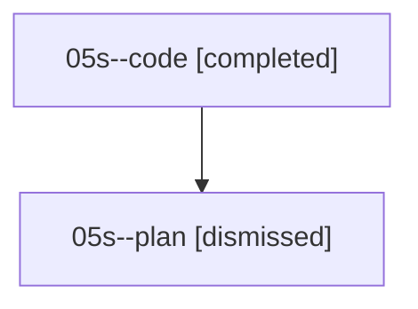

# Session: 05s

[Agent Hoods](../README.md) / [bbugyi200](../users/bbugyi200/README.md) / [athena](../users/bbugyi200/machines/athena/README.md) / [05s](../users/bbugyi200/machines/athena/hoods/05s/README.md) / 05s

Owner: `bbugyi200.athena` · Hood: `05s` · Members: 2

## Lineage

The diagram is an optional enhancement; the ordered table below contains the same lineage in accessible text.

| Role | Agent | State | Model / provider | Timing | Commits | Prompt | Chat |
|---|---|---|---|---|---:|---|---|
| code | 05s--code | completed | sonnet / claude | 2026-08-18T11:26:40.167667+00:00 | [1](../agents/bbugyi200.athena.05s--code/README.md#commits) | — | [Chat](../agents/bbugyi200.athena.05s--code/chat.md) |
| plan | 05s--plan | dismissed | opus / claude | 2026-08-18T07:17:11 | 0 | [Prompt](../agents/bbugyi200.athena.05s--plan/prompt.md) | [Chat](../agents/bbugyi200.athena.05s--plan/chat.md) |

## Commits

| Role | Repo | Commit | Subject | Committed |
|---|---|---|---|---|
| — | — | `d8f60e7` | chore: Add SDD prompt and plan for update\_pinned\_prompt\_stash | 2026-06-25 07:28:45 EDT |
| — | — | `a439daf` | feat(tui): update pinned prompt stash | 2026-06-25 07:48:58 EDT |
| code | — | `9d6d48c` | feat(memory): add \`sase memory show\` and share resolve/render logic with \`read\` | 2026-08-18 07:55:41 EDT |
