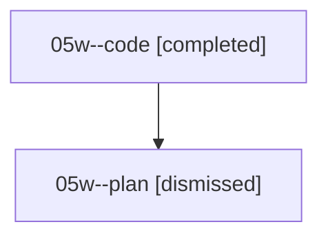

# Session: 05w

[Agent Hoods](../README.md) / [bbugyi200](../users/bbugyi200/README.md) / [athena](../users/bbugyi200/machines/athena/README.md) / [05w](../users/bbugyi200/machines/athena/hoods/05w/README.md) / 05w

Owner: `bbugyi200.athena` · Hood: `05w` · Members: 2

## Lineage

The diagram is an optional enhancement; the ordered table below contains the same lineage in accessible text.

| Role | Agent | State | Model / provider | Timing | Commits | Prompt | Chat |
|---|---|---|---|---|---:|---|---|
| code | 05w--code | completed | grok-4.6 / grok | 2026-08-18T11:54:09.700434+00:00 | [1](../agents/bbugyi200.athena.05w--code/README.md#commits) | — | [Chat](../agents/bbugyi200.athena.05w--code/chat.md) |
| plan | 05w--plan | dismissed | opus / claude | 2026-08-18T07:43:21 | 0 | [Prompt](../agents/bbugyi200.athena.05w--plan/prompt.md) | [Chat](../agents/bbugyi200.athena.05w--plan/chat.md) |

## Commits

| Role | Repo | Commit | Subject | Committed |
|---|---|---|---|---|
| — | — | `c297507` | chore: Add SDD prompt and plan for wait\_directive\_canonical\_duration | 2026-06-25 08:00:48 EDT |
| — | — | `bb04443` | fix(xprompt): disambiguate leading-zero wait names | 2026-06-25 08:11:39 EDT |
| code | — | `69ec946` | feat(llm\_provider): add optional weights to load-balanced model alias pools | 2026-08-18 08:28:46 EDT |

## Neighbors

| Agent | Relation | State |
|---|---|---|
| [05w.f0](../agents/bbugyi200.athena.05w.f0/README.md) | descendant | dismissed |
