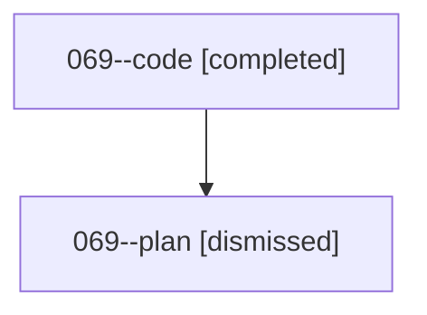

# Session: 069

[Agent Hoods](../README.md) / [bbugyi200](../users/bbugyi200/README.md) / [athena](../users/bbugyi200/machines/athena/README.md) / [069](../users/bbugyi200/machines/athena/hoods/069/README.md) / 069

Owner: `bbugyi200.athena` · Hood: `069` · Members: 2

## Lineage

The diagram is an optional enhancement; the ordered table below contains the same lineage in accessible text.

| Role | Agent | State | Model / provider | Timing | Commits | Prompt | Chat |
|---|---|---|---|---|---:|---|---|
| code | 069--code | completed | grok-4.6 / grok | 2026-08-18T14:51:04.703706+00:00 | [1](../agents/bbugyi200.athena.069--code/README.md#commits) | — | [Chat](../agents/bbugyi200.athena.069--code/chat.md) |
| plan | 069--plan | dismissed | opus / claude | 2026-08-18T10:41:40 | 0 | [Prompt](../agents/bbugyi200.athena.069--plan/prompt.md) | [Chat](../agents/bbugyi200.athena.069--plan/chat.md) |

## Commits

| Role | Repo | Commit | Subject | Committed |
|---|---|---|---|---|
| — | — | `ae536e9` | chore: Add SDD prompt and plan for reject\_plan\_command | 2026-06-25 15:01:48 EDT |
| — | — | `83f155c` | feat(plan): add \`sase plan reject\` CLI command | 2026-06-25 15:27:15 EDT |
| code | — | `88fa6e9` | feat(glossary): fail batched reads all-or-nothing and shrink render bytes | 2026-08-18 11:51:59 EDT |
