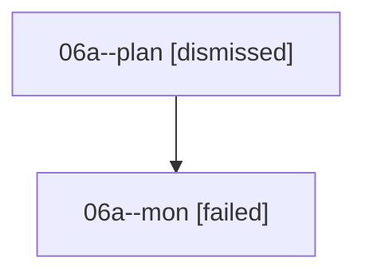

# Session: 06a

[Agent Hoods](../README.md) / [bbugyi200](../users/bbugyi200/README.md) / [athena](../users/bbugyi200/machines/athena/README.md) / [06a](../users/bbugyi200/machines/athena/hoods/06a/README.md) / 06a

Owner: `bbugyi200.athena` · Hood: `06a` · Members: 2

## Lineage

The diagram is an optional enhancement; the ordered table below contains the same lineage in accessible text.

| Role | Agent | State | Model / provider | Timing | Commits | Prompt | Chat |
|---|---|---|---|---|---:|---|---|
| plan | 06a--plan | dismissed | opus / claude | 2026-08-18T11:07:25 | 0 | [Prompt](../agents/bbugyi200.athena.06a--plan/prompt.md) | [Chat](../agents/bbugyi200.athena.06a--plan/chat.md) |
| mon | 06a--mon | failed | opus / claude | 2026-08-18T15:25:55.487163+00:00 | 0 | — | [Chat](../agents/bbugyi200.athena.06a--mon/chat.md) |

## Commits

| Role | Repo | Commit | Subject | Committed |
|---|---|---|---|---|
| — | — | `03110b4` | chore: Add SDD prompt and plan for agent\_prompt\_wrap\_width | 2026-06-25 15:02:19 EDT |
| — | — | `b09728a` | feat(llm): wrap agent prompts at 80 columns | 2026-06-25 15:09:52 EDT |
