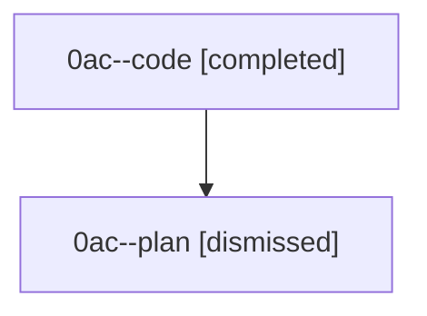

# Session: 0ac

[Agent Hoods](../README.md) / [bbugyi200](../users/bbugyi200/README.md) / [athena](../users/bbugyi200/machines/athena/README.md) / [0ac](../users/bbugyi200/machines/athena/hoods/0ac/README.md) / 0ac

Owner: `bbugyi200.athena` · Hood: `0ac` · Members: 2

## Lineage

The diagram is an optional enhancement; the ordered table below contains the same lineage in accessible text.

| Role | Agent | State | Model / provider | Timing | Commits | Prompt | Chat |
|---|---|---|---|---|---:|---|---|
| code | 0ac--code | completed | grok-4.6 / grok | 2026-08-22T10:52:39.715435+00:00 → 2026-08-22T11:44:39.802720+00:00 | [1](../agents/bbugyi200.athena.0ac--code/README.md#commits) | — | [Chat](../agents/bbugyi200.athena.0ac--code/chat.md) |
| plan | 0ac--plan | dismissed | gpt-5.6-sol / codex | 2026-08-22T10:36:54 | 0 | [Prompt](../agents/bbugyi200.athena.0ac--plan/prompt.md) | [Chat](../agents/bbugyi200.athena.0ac--plan/chat.md) |

## Commits

| Role | Repo | Commit | Subject | Committed |
|---|---|---|---|---|
| — | — | `a79c174` | chore: Add SDD prompt and plan for neighbor\_keymap\_includes\_ancestors | 2026-06-29 12:59:31 EDT |
| — | — | `4ffd1f1` | feat(tui): include ancestors in agent neighbor jumps | 2026-06-29 13:10:59 EDT |
| code | — | `45be84b` | fix(ace): keep the prompt editor visible under long completions | 2026-08-22 07:44:01 EDT |
