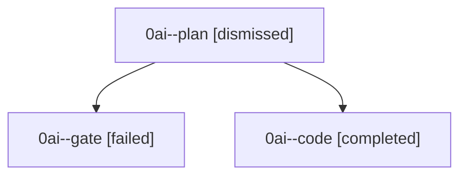

# Session: 0ai

[Agent Hoods](../README.md) / [bbugyi200](../users/bbugyi200/README.md) / [athena](../users/bbugyi200/machines/athena/README.md) / [0ai](../users/bbugyi200/machines/athena/hoods/0ai/README.md) / 0ai

Owner: `bbugyi200.athena` · Hood: `0ai` · Members: 3

## Lineage

The diagram is an optional enhancement; the ordered table below contains the same lineage in accessible text.

| Role | Agent | State | Model / provider | Timing | Commits | Prompt | Chat |
|---|---|---|---|---|---:|---|---|
| plan | 0ai--plan | dismissed | gpt-5.6-sol / codex | 2026-09-08T15:30:21.698893 → 2026-09-08T15:40:50.009168 | 0 | [Prompt](../agents/bbugyi200.athena.0ai--plan/prompt.md) | [Chat](../agents/bbugyi200.athena.0ai--plan/chat.md) |
| gate | 0ai--gate | failed | gpt-5.6-sol / codex | 2026-09-08T19:39:38.498702+00:00 → 2026-09-08T19:41:38.225531+00:00 | 0 | — | [Chat](../agents/bbugyi200.athena.0ai--gate/chat.md) |
| code | 0ai--code | completed | gpt-5.5 / codex | 2026-09-08T19:41:46.243373+00:00 → 2026-09-08T20:18:00.844573+00:00 | [1](../agents/bbugyi200.athena.0ai--code/README.md#commits) | [Prompt](../agents/bbugyi200.athena.0ai--code/prompt.md) | [Chat](../agents/bbugyi200.athena.0ai--code/chat.md) |

## Commits

| Role | Repo | Commit | Subject | Committed |
|---|---|---|---|---|
| — | — | `9866e20` | chore: Add SDD prompt and plan for onboarding\_pick\_line\_gate | 2026-06-30 07:21:46 EDT |
| — | — | `1b9395b` | fix(ace): hide onboarding launch hint without targets | 2026-06-30 07:36:39 EDT |
| code | — | `95295fe` | fix(snippets): allow unused prefix triggers | 2026-09-08 16:13:45 EDT |
