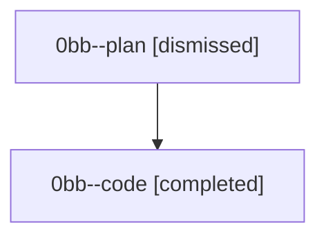

# Session: 0bb

[Agent Hoods](../README.md) / [bbugyi200](../users/bbugyi200/README.md) / [athena](../users/bbugyi200/machines/athena/README.md) / [0bb](../users/bbugyi200/machines/athena/hoods/0bb/README.md) / 0bb

Owner: `bbugyi200.athena` · Hood: `0bb` · Members: 2

## Lineage

The diagram is an optional enhancement; the ordered table below contains the same lineage in accessible text.

| Role | Agent | State | Model / provider | Timing | Commits | Prompt | Chat |
|---|---|---|---|---|---:|---|---|
| plan | 0bb--plan | dismissed | gpt-5.6-sol / codex | 2026-08-22T18:34:37 | 0 | [Prompt](../agents/bbugyi200.athena.0bb--plan/prompt.md) | [Chat](../agents/bbugyi200.athena.0bb--plan/chat.md) |
| code | 0bb--code | completed | gpt-5.5 / codex | 2026-08-22T18:41:44.056603+00:00 → 2026-08-22T18:57:05.777866+00:00 | [1](../agents/bbugyi200.athena.0bb--code/README.md#commits) | — | [Chat](../agents/bbugyi200.athena.0bb--code/chat.md) |

## Commits

| Role | Repo | Commit | Subject | Committed |
|---|---|---|---|---|
| — | — | `ccc2636` | chore: Add SDD prompt and plan for agents\_starting\_total | 2026-07-02 05:54:07 EDT |
| — | — | `97f34fa` | fix(ace): include STARTING agents in Agents tab headline total | 2026-07-02 06:03:21 EDT |
| code | — | `2e7a723` | docs(memory): add AXE glossary terms | 2026-08-22 14:54:34 EDT |
