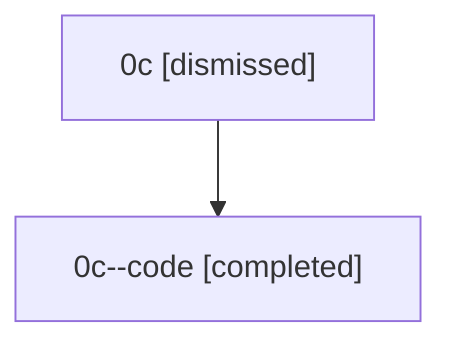

# Session: 0c

[Agent Hoods](../README.md) / [bbugyi200](../users/bbugyi200/README.md) / [athena](../users/bbugyi200/machines/athena/README.md) / [0c](../users/bbugyi200/machines/athena/hoods/0c/README.md) / 0c

Owner: `bbugyi200.athena` · Hood: `0c` · Members: 2

## Lineage

The diagram is an optional enhancement; the ordered table below contains the same lineage in accessible text.

| Role | Agent | State | Model / provider | Timing | Commits | Prompt | Chat |
|---|---|---|---|---|---:|---|---|
| root | 0c | dismissed | opus / claude | 2026-07-07T00:43:49.333855 → 2026-07-07T01:21:55.512233 | [1](../agents/bbugyi200.athena.0c/README.md#commits) | [Prompt](../agents/bbugyi200.athena.0c/prompt.md) | [Chat](../agents/bbugyi200.athena.0c/chat.md) |
| code | 0c--code | completed | gpt-5.5 / codex | 2026-07-07T05:07:12.246861+00:00 | [1](../agents/bbugyi200.athena.0c--code/README.md#commits) | — | [Chat](../agents/bbugyi200.athena.0c--code/chat.md) |

## Commits

| Role | Repo | Commit | Subject | Committed |
|---|---|---|---|---|
| — | — | `b1bf540` | chore: Add SDD prompt and plan for config\_edit\_modal\_fullscreen | 2026-07-05 19:24:25 EDT |
| — | — | `f56f137` | feat(tui): expand config edit modal for multiline content | 2026-07-05 19:59:00 EDT |
| root | — | `90777bd` | chore: Add SDD prompt and plan for launch\_preview\_pdf | 2026-07-07 01:07:11 EDT |
| code | — | `8aa58d6` | feat: render launch previews as highlighted PDFs | 2026-07-07 01:21:08 EDT |
