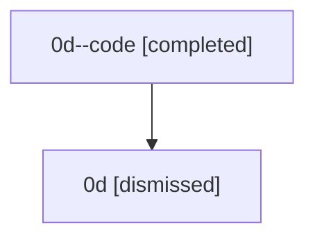

# Session: 0d

[Agent Hoods](../README.md) / [bbugyi200](../users/bbugyi200/README.md) / [athena](../users/bbugyi200/machines/athena/README.md) / [0d](../users/bbugyi200/machines/athena/hoods/0d/README.md) / 0d

Owner: `bbugyi200.athena` · Hood: `0d` · Members: 2

## Lineage

The diagram is an optional enhancement; the ordered table below contains the same lineage in accessible text.

| Role | Agent | State | Model / provider | Timing | Commits | Prompt | Chat |
|---|---|---|---|---|---:|---|---|
| code | 0d--code | completed | gpt-5.5 / codex | 2026-07-07T06:06:34.321523+00:00 | [1](../agents/bbugyi200.athena.0d--code/README.md#commits) | — | [Chat](../agents/bbugyi200.athena.0d--code/chat.md) |
| root | 0d | dismissed | claude-fable-5 / claude | 2026-07-07T01:54:38.379472 → 2026-07-07T02:19:41.003370 | [1](../agents/bbugyi200.athena.0d/README.md#commits) | [Prompt](../agents/bbugyi200.athena.0d/prompt.md) | [Chat](../agents/bbugyi200.athena.0d/chat.md) |

## Commits

| Role | Repo | Commit | Subject | Committed |
|---|---|---|---|---|
| — | — | `26767ec` | chore: Add SDD prompt and plan for vim\_text\_area\_adoption | 2026-07-05 19:48:52 EDT |
| — | — | `085054e` | feat(tui): adopt vim text areas for modal inputs | 2026-07-05 20:49:46 EDT |
| root | — | `5785c09` | chore: Add SDD prompt and plan for telegram\_project\_display\_names\_1 | 2026-07-07 02:06:33 EDT |
| code | — | `0654041` | feat: humanize safe project filename stems | 2026-07-07 02:19:02 EDT |
