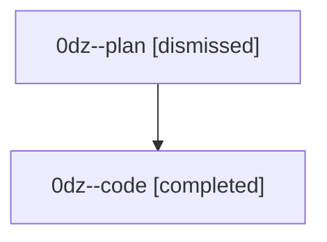

# Session: 0dz

[Agent Hoods](../README.md) / [bbugyi200](../users/bbugyi200/README.md) / [athena](../users/bbugyi200/machines/athena/README.md) / [0dz](../users/bbugyi200/machines/athena/hoods/0dz/README.md) / 0dz

Owner: `bbugyi200.athena` · Hood: `0dz` · Members: 2

## Lineage

The diagram is an optional enhancement; the ordered table below contains the same lineage in accessible text.

| Role | Agent | State | Model / provider | Timing | Commits | Prompt | Chat |
|---|---|---|---|---|---:|---|---|
| plan | 0dz--plan | dismissed | opus / claude | 2026-08-26T07:08:42 | 0 | [Prompt](../agents/bbugyi200.athena.0dz--plan/prompt.md) | [Chat](../agents/bbugyi200.athena.0dz--plan/chat.md) |
| code | 0dz--code | completed | gpt-5.5 / codex | 2026-08-26T11:20:44.389681+00:00 → 2026-08-26T16:43:07.222702+00:00 | [1](../agents/bbugyi200.athena.0dz--code/README.md#commits) | — | [Chat](../agents/bbugyi200.athena.0dz--code/chat.md) |

## Commits

| Role | Repo | Commit | Subject | Committed |
|---|---|---|---|---|
| code | — | `a301139` | fix(finalizers): run repair follow-up commits | 2026-08-26 12:42:23 EDT |
