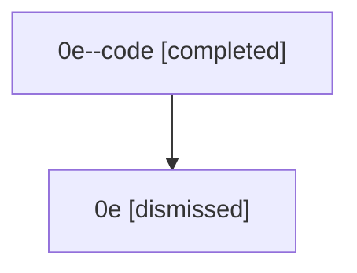

# Session: 0e

[Agent Hoods](../README.md) / [bbugyi200](../users/bbugyi200/README.md) / [athena](../users/bbugyi200/machines/athena/README.md) / [0e](../users/bbugyi200/machines/athena/hoods/0e/README.md) / 0e

Owner: `bbugyi200.athena` · Hood: `0e` · Members: 2

## Lineage

The diagram is an optional enhancement; the ordered table below contains the same lineage in accessible text.

| Role | Agent | State | Model / provider | Timing | Commits | Prompt | Chat |
|---|---|---|---|---|---:|---|---|
| code | 0e--code | completed | gpt-5.5 / codex | 2026-07-07T15:13:40.459757+00:00 | [1](../agents/bbugyi200.athena.0e--code/README.md#commits) | — | [Chat](../agents/bbugyi200.athena.0e--code/chat.md) |
| root | 0e | dismissed | gpt-5.5 / codex | 2026-07-07T11:00:37.715194 → 2026-07-07T11:28:56.778537 | [1](../agents/bbugyi200.athena.0e/README.md#commits) | [Prompt](../agents/bbugyi200.athena.0e/prompt.md) | [Chat](../agents/bbugyi200.athena.0e/chat.md) |

## Commits

| Role | Repo | Commit | Subject | Committed |
|---|---|---|---|---|
| — | — | `5924868` | chore: Add SDD prompt and plan for sase\_var\_output\_variables | 2026-06-02 20:19:08 EDT |
| — | — | `68716ab` | chore: create sase var output variable epic beads | 2026-06-02 20:23:43 EDT |
| — | — | `932b6fa` | chore: Add SDD prompt and plan for agents\_tab\_auto\_approve\_prefix\_and\_child\_alignment | 2026-07-05 21:37:09 EDT |
| — | — | `3e4c53d` | fix(tui): align workflow child approval indicators | 2026-07-05 22:18:56 EDT |
| root | — | `c5f48b6` | chore: Add SDD prompt and plan for popup\_panel\_tab\_switch\_keymaps | 2026-07-07 11:13:39 EDT |
| code | — | `904a3e1` | fix(ace): support tab switching in popup panels | 2026-07-07 11:28:42 EDT |

## Neighbors

| Agent | Relation | State |
|---|---|---|
| [0e.w1](bbugyi200.athena.0e.w1.md) (session · 2) | descendant | completed 1, dismissed 1 |
| [0e.w1.w1](bbugyi200.athena.0e.w1.w1.md) (session · 2) | descendant | completed 1, dismissed 1 |
| [0e.w1.w1.w1](bbugyi200.athena.0e.w1.w1.w1.md) (session · 2) | descendant | completed 1, dismissed 1 |
| [0e.w1.w1.w1.f1](bbugyi200.athena.0e.w1.w1.w1.f1.md) (session · 2) | descendant | completed 1, dismissed 1 |
