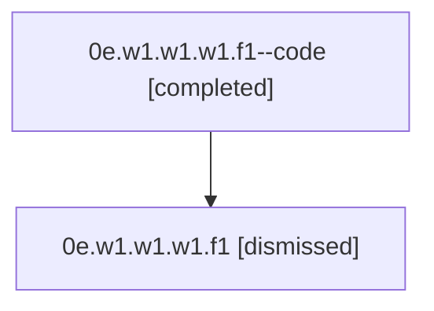

# Session: 0e.w1.w1.w1.f1

[Agent Hoods](../README.md) / [bbugyi200](../users/bbugyi200/README.md) / [athena](../users/bbugyi200/machines/athena/README.md) / [0e](../users/bbugyi200/machines/athena/hoods/0e/README.md) / 0e.w1.w1.w1.f1

Owner: `bbugyi200.athena` · Hood: `0e` · Members: 2

## Lineage

The diagram is an optional enhancement; the ordered table below contains the same lineage in accessible text.

| Role | Agent | State | Model / provider | Timing | Commits | Prompt | Chat |
|---|---|---|---|---|---:|---|---|
| code | 0e.w1.w1.w1.f1--code | completed | gpt-5.5 / codex | 2026-07-07T17:47:00.413377+00:00 | [1](../agents/bbugyi200.athena.0e.w1.w1.w1.f1--code/README.md#commits) | — | [Chat](../agents/bbugyi200.athena.0e.w1.w1.w1.f1--code/chat.md) |
| root | 0e.w1.w1.w1.f1 | dismissed | gpt-5.5 / codex | 2026-07-07T13:43:45.392926 → 2026-07-07T13:56:38.824171 | [1](../agents/bbugyi200.athena.0e.w1.w1.w1.f1/README.md#commits) | [Prompt](../agents/bbugyi200.athena.0e.w1.w1.w1.f1/prompt.md) | [Chat](../agents/bbugyi200.athena.0e.w1.w1.w1.f1/chat.md) |

## Commits

| Role | Repo | Commit | Subject | Committed |
|---|---|---|---|---|
| root | — | `9d16bd5` | chore: Add SDD prompt and plan for expand\_help\_panel | 2026-07-07 13:46:59 EDT |
| code | — | `306b5ec` | fix(ace): expand help panel viewport usage | 2026-07-07 13:56:22 EDT |

## Neighbors

| Agent | Relation | State |
|---|---|---|
| [0e.w1.w1.w1](bbugyi200.athena.0e.w1.w1.w1.md) (session · 2) | ancestor | completed 1, dismissed 1 |
| [0e.w1.w1](bbugyi200.athena.0e.w1.w1.md) (session · 2) | ancestor | completed 1, dismissed 1 |
| [0e.w1](bbugyi200.athena.0e.w1.md) (session · 2) | ancestor | completed 1, dismissed 1 |
| [0e](bbugyi200.athena.0e.md) (session · 2) | ancestor | completed 1, dismissed 1 |
