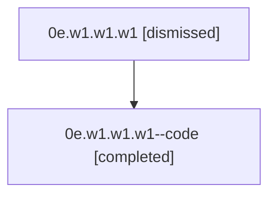

# Session: 0e.w1.w1.w1

[Agent Hoods](../README.md) / [bbugyi200](../users/bbugyi200/README.md) / [athena](../users/bbugyi200/machines/athena/README.md) / [0e](../users/bbugyi200/machines/athena/hoods/0e/README.md) / 0e.w1.w1.w1

Owner: `bbugyi200.athena` · Hood: `0e` · Members: 2

## Lineage

The diagram is an optional enhancement; the ordered table below contains the same lineage in accessible text.

| Role | Agent | State | Model / provider | Timing | Commits | Prompt | Chat |
|---|---|---|---|---|---:|---|---|
| root | 0e.w1.w1.w1 | dismissed | claude-fable-5 / claude | 2026-07-07T12:57:17.907507 → 2026-07-07T13:35:15.421661 | [1](../agents/bbugyi200.athena.0e.w1.w1.w1/README.md#commits) | [Prompt](../agents/bbugyi200.athena.0e.w1.w1.w1/prompt.md) | [Chat](../agents/bbugyi200.athena.0e.w1.w1.w1/chat.md) |
| code | 0e.w1.w1.w1--code | completed | gpt-5.5 / codex | 2026-07-07T17:05:41.113801+00:00 | [1](../agents/bbugyi200.athena.0e.w1.w1.w1--code/README.md#commits) | — | [Chat](../agents/bbugyi200.athena.0e.w1.w1.w1--code/chat.md) |

## Commits

| Role | Repo | Commit | Subject | Committed |
|---|---|---|---|---|
| root | — | `63ea7d9` | chore: Add SDD prompt and plan for merge\_help\_and\_tab\_guide\_panels | 2026-07-07 13:05:39 EDT |
| code | — | `0862efa` | feat(ace)!: merge tab guide into help panel | 2026-07-07 13:34:59 EDT |

## Neighbors

| Agent | Relation | State |
|---|---|---|
| [0e.w1.w1](bbugyi200.athena.0e.w1.w1.md) (session · 2) | ancestor | completed 1, dismissed 1 |
| [0e.w1](bbugyi200.athena.0e.w1.md) (session · 2) | ancestor | completed 1, dismissed 1 |
| [0e](bbugyi200.athena.0e.md) (session · 2) | ancestor | completed 1, dismissed 1 |
| [0e.w1.w1.w1.f1](bbugyi200.athena.0e.w1.w1.w1.f1.md) (session · 2) | descendant | completed 1, dismissed 1 |
