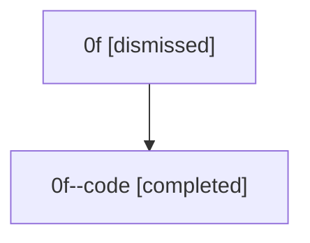

# Session: 0f

[Agent Hoods](../README.md) / [bbugyi200](../users/bbugyi200/README.md) / [athena](../users/bbugyi200/machines/athena/README.md) / [0f](../users/bbugyi200/machines/athena/hoods/0f/README.md) / 0f

Owner: `bbugyi200.athena` · Hood: `0f` · Members: 2

## Lineage

The diagram is an optional enhancement; the ordered table below contains the same lineage in accessible text.

| Role | Agent | State | Model / provider | Timing | Commits | Prompt | Chat |
|---|---|---|---|---|---:|---|---|
| root | 0f | dismissed | claude-fable-5 / claude | 2026-07-07T11:04:36.986070 → 2026-07-07T11:22:56.929427 | [1](../agents/bbugyi200.athena.0f/README.md#commits) | [Prompt](../agents/bbugyi200.athena.0f/prompt.md) | [Chat](../agents/bbugyi200.athena.0f/chat.md) |
| code | 0f--code | completed | gpt-5.5 / codex | 2026-07-07T15:13:24.782950+00:00 | [1](../agents/bbugyi200.athena.0f--code/README.md#commits) | — | [Chat](../agents/bbugyi200.athena.0f--code/chat.md) |

## Commits

| Role | Repo | Commit | Subject | Committed |
|---|---|---|---|---|
| — | — | `96c4c83` | chore: Add SDD prompt and plan for fix\_ci\_tz\_day\_boundary\_flake | 2026-07-05 22:18:52 EDT |
| — | — | `417c39a` | test: align wait time expectations with local clock | 2026-07-05 22:39:37 EDT |
| root | — | `2c76165` | chore: Add SDD prompt and plan for fix\_marked\_install\_snapshot\_flake | 2026-07-07 11:13:23 EDT |
| code | — | `aabcbf2` | test: stabilize marked install snapshot | 2026-07-07 11:22:41 EDT |
