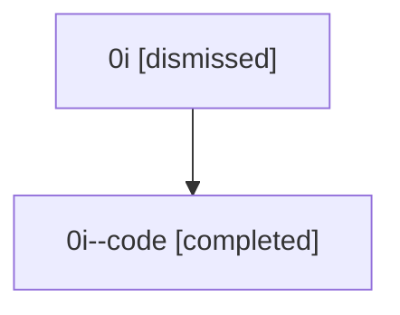

# Session: 0i

[Agent Hoods](../README.md) / [bbugyi200](../users/bbugyi200/README.md) / [athena](../users/bbugyi200/machines/athena/README.md) / [0i](../users/bbugyi200/machines/athena/hoods/0i/README.md) / 0i

Owner: `bbugyi200.athena` · Hood: `0i` · Members: 2

## Lineage

The diagram is an optional enhancement; the ordered table below contains the same lineage in accessible text.

| Role | Agent | State | Model / provider | Timing | Commits | Prompt | Chat |
|---|---|---|---|---|---:|---|---|
| root | 0i | dismissed | claude-fable-5 / claude | 2026-07-07T11:45:37.937448 → 2026-07-07T12:08:23.147120 | [1](../agents/bbugyi200.athena.0i/README.md#commits) | [Prompt](../agents/bbugyi200.athena.0i/prompt.md) | [Chat](../agents/bbugyi200.athena.0i/chat.md) |
| code | 0i--code | completed | gpt-5.5 / codex | 2026-07-07T15:57:22.257446+00:00 | [1](../agents/bbugyi200.athena.0i--code/README.md#commits) | — | [Chat](../agents/bbugyi200.athena.0i--code/chat.md) |

## Commits

| Role | Repo | Commit | Subject | Committed |
|---|---|---|---|---|
| — | — | `54e5c19` | chore: Add SDD prompt and plan for jump\_all\_scroll | 2026-06-02 21:19:04 EDT |
| — | — | `9437080` | fix: keep jump-all scroll keys from dismissing | 2026-06-02 21:25:47 EDT |
| — | — | `12243a7` | chore: Add SDD prompt and plan for atomic\_rust\_dev\_update | 2026-07-06 00:04:12 EDT |
| — | — | `44c9096` | fix: harden dev update rust repair flow | 2026-07-06 00:49:12 EDT |
| root | — | `21ce93d` | chore: Add SDD prompt and plan for gh\_first\_use\_project\_display | 2026-07-07 11:57:21 EDT |
| code | — | `9a30501` | fix: use canonical workspace refs in launches | 2026-07-07 12:07:46 EDT |
