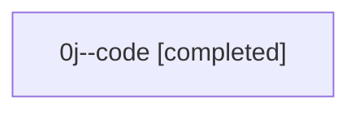

# Session: 0j

[Agent Hoods](../README.md) / [bbugyi200](../users/bbugyi200/README.md) / [athena](../users/bbugyi200/machines/athena/README.md) / [0j](../users/bbugyi200/machines/athena/hoods/0j/README.md) / 0j

Owner: `bbugyi200.athena` · Hood: `0j` · Members: 1

## Lineage

The diagram is an optional enhancement; the ordered table below contains the same lineage in accessible text.

| Role | Agent | State | Model / provider | Timing | Commits | Prompt | Chat |
|---|---|---|---|---|---:|---|---|
| code | 0j--code | completed | gpt-5.5 / codex | 2026-07-07T16:16:50.391520+00:00 | [1](../agents/bbugyi200.athena.0j--code/README.md#commits) | — | [Chat](../agents/bbugyi200.athena.0j--code/chat.md) |

## Commits

| Role | Repo | Commit | Subject | Committed |
|---|---|---|---|---|
| — | — | `9763639` | chore: Add SDD prompt and plan for fix\_bead\_display\_flicker | 2026-07-06 00:32:17 EDT |
| — | — | `47a7d5d` | fix(tui): keep bead displays visible while revalidating | 2026-07-06 01:26:22 EDT |
| — | — | `eeb6f73` | chore: Add SDD prompt and plan for update\_confirm\_incoming\_commits | 2026-07-07 12:16:48 EDT |
| code | — | `ad66f33` | feat(tui): show incoming commits in update confirmations | 2026-07-07 12:42:29 EDT |

## Neighbors

| Agent | Relation | State |
|---|---|---|
| [0j.f1](../agents/bbugyi200.athena.0j.f1/README.md) | descendant | completed |
