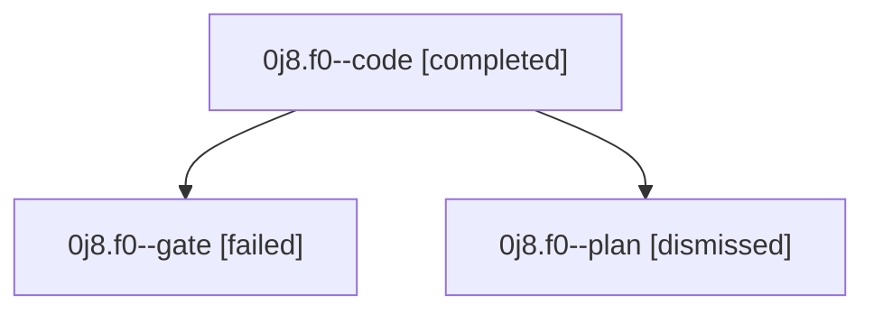

# Session: 0j8.f0

[Agent Hoods](../README.md) / [bbugyi200](../users/bbugyi200/README.md) / [athena](../users/bbugyi200/machines/athena/README.md) / [0j8](../users/bbugyi200/machines/athena/hoods/0j8/README.md) / 0j8.f0

Owner: `bbugyi200.athena` · Hood: `0j8` · Members: 3

## Lineage

The diagram is an optional enhancement; the ordered table below contains the same lineage in accessible text.

| Role | Agent | State | Model / provider | Timing | Commits | Prompt | Chat |
|---|---|---|---|---|---:|---|---|
| code | 0j8.f0--code | completed | gpt-5.5 / codex | 2026-09-11T12:54:27.895955+00:00 → 2026-09-11T13:44:16.571888+00:00 | [1](../agents/bbugyi200.athena.0j8.f0--code/README.md#commits) | [Prompt](../agents/bbugyi200.athena.0j8.f0--code/prompt.md) | [Chat](../agents/bbugyi200.athena.0j8.f0--code/chat.md) |
| gate | 0j8.f0--gate | failed | gpt-5.6-sol / codex | 2026-09-11T12:53:19.324159+00:00 → 2026-09-11T12:54:09.699353+00:00 | 0 | — | [Chat](../agents/bbugyi200.athena.0j8.f0--gate/chat.md) |
| plan | 0j8.f0--plan | dismissed | gpt-5.6-sol / codex | 2026-09-11T08:44:30.932698 → 2026-09-11T08:50:38.066091 | 0 | [Prompt](../agents/bbugyi200.athena.0j8.f0--plan/prompt.md) | [Chat](../agents/bbugyi200.athena.0j8.f0--plan/chat.md) |

## Commits

| Role | Repo | Commit | Subject | Committed |
|---|---|---|---|---|
| code | — | `afbfc08` | feat(ace): emphasize exhausted usage indicators | 2026-09-11 09:41:06 EDT |

## Neighbors

| Agent | Relation | State |
|---|---|---|
| [0j8](bbugyi200.athena.0j8.md) (session · 3) | ancestor | completed 1, dismissed 1, failed 1 |
| [0j8.f0.f0](../agents/bbugyi200.athena.0j8.f0.f0/README.md) | descendant | dismissed |
| [0j8.f0.f1](../agents/bbugyi200.athena.0j8.f0.f1/README.md) | descendant | dismissed |
| [0j8.f0.f2](bbugyi200.athena.0j8.f0.f2.md) (session · 2) | descendant | dismissed 1, failed 1 |
| [0j8.f0.f2.f0](bbugyi200.athena.0j8.f0.f2.f0.md) (session · 3) | descendant | dismissed 1, failed 2 |
