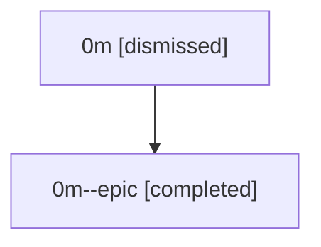

# Session: 0m

[Agent Hoods](../README.md) / [bbugyi200](../users/bbugyi200/README.md) / [athena](../users/bbugyi200/machines/athena/README.md) / [0m](../users/bbugyi200/machines/athena/hoods/0m/README.md) / 0m

Owner: `bbugyi200.athena` · Hood: `0m` · Members: 2

## Lineage

The diagram is an optional enhancement; the ordered table below contains the same lineage in accessible text.

| Role | Agent | State | Model / provider | Timing | Commits | Prompt | Chat |
|---|---|---|---|---|---:|---|---|
| root | 0m | dismissed | claude-fable-5 / claude | 2026-07-07T12:54:46.644187 → 2026-07-07T13:21:41.514321 | [1](../agents/bbugyi200.athena.0m/README.md#commits) | [Prompt](../agents/bbugyi200.athena.0m/prompt.md) | [Chat](../agents/bbugyi200.athena.0m/chat.md) |
| epic | 0m--epic | completed | gpt-5.5 / codex | 2026-07-07T17:10:34.763848+00:00 | [1](../agents/bbugyi200.athena.0m--epic/README.md#commits) | — | [Chat](../agents/bbugyi200.athena.0m--epic/chat.md) |

## Commits

| Role | Repo | Commit | Subject | Committed |
|---|---|---|---|---|
| root | — | `bee58b4` | chore: Add SDD prompt and plan for vcs\_repo\_slash\_completion | 2026-07-07 13:10:33 EDT |
| epic | — | `cb5f4cf` | chore(beads): create VCS repo completion epic | 2026-07-07 13:20:20 EDT |
