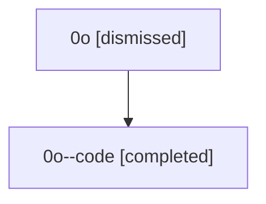

# Session: 0o

[Agent Hoods](../README.md) / [bbugyi200](../users/bbugyi200/README.md) / [athena](../users/bbugyi200/machines/athena/README.md) / [0o](../users/bbugyi200/machines/athena/hoods/0o/README.md) / 0o

Owner: `bbugyi200.athena` · Hood: `0o` · Members: 2

## Lineage

The diagram is an optional enhancement; the ordered table below contains the same lineage in accessible text.

| Role | Agent | State | Model / provider | Timing | Commits | Prompt | Chat |
|---|---|---|---|---|---:|---|---|
| root | 0o | dismissed | claude-fable-5 / claude | 2026-07-07T13:41:47.035208 → 2026-07-07T14:04:08.453919 | [1](../agents/bbugyi200.athena.0o/README.md#commits) | [Prompt](../agents/bbugyi200.athena.0o/prompt.md) | [Chat](../agents/bbugyi200.athena.0o/chat.md) |
| code | 0o--code | completed | gpt-5.5 / codex | 2026-07-07T17:49:57.729706+00:00 | [1](../agents/bbugyi200.athena.0o--code/README.md#commits) | — | [Chat](../agents/bbugyi200.athena.0o--code/chat.md) |

## Commits

| Role | Repo | Commit | Subject | Committed |
|---|---|---|---|---|
| root | — | `68cb9a9` | chore: Add SDD prompt and plan for dev\_update\_editable\_overrides | 2026-07-07 13:49:56 EDT |
| code | — | `c91a032` | fix(uv-tool): write editable overrides for tool reinstalls | 2026-07-07 14:03:48 EDT |
