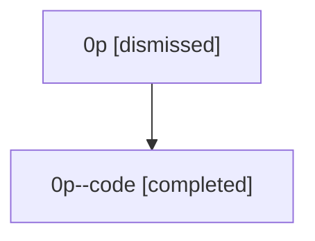

# Session: 0p

[Agent Hoods](../README.md) / [bbugyi200](../users/bbugyi200/README.md) / [athena](../users/bbugyi200/machines/athena/README.md) / [0p](../users/bbugyi200/machines/athena/hoods/0p/README.md) / 0p

Owner: `bbugyi200.athena` · Hood: `0p` · Members: 2

## Lineage

The diagram is an optional enhancement; the ordered table below contains the same lineage in accessible text.

| Role | Agent | State | Model / provider | Timing | Commits | Prompt | Chat |
|---|---|---|---|---|---:|---|---|
| root | 0p | dismissed | claude-fable-5 / claude | 2026-07-07T13:54:54.437504 → 2026-07-07T14:24:10.291678 | [1](../agents/bbugyi200.athena.0p/README.md#commits) | [Prompt](../agents/bbugyi200.athena.0p/prompt.md) | [Chat](../agents/bbugyi200.athena.0p/chat.md) |
| code | 0p--code | completed | gpt-5.5 / codex | 2026-07-07T18:06:48.577621+00:00 | [1](../agents/bbugyi200.athena.0p--code/README.md#commits) | — | [Chat](../agents/bbugyi200.athena.0p--code/chat.md) |

## Commits

| Role | Repo | Commit | Subject | Committed |
|---|---|---|---|---|
| — | — | `2cc38ed` | chore: Add SDD prompt and plan for output\_var\_digit\_namespaces | 2026-06-02 23:12:48 EDT |
| — | — | `49dcdcb` | fix: normalize digit-leading output variable namespaces | 2026-06-02 23:21:26 EDT |
| root | — | `987b2dd` | chore: Add SDD prompt and plan for xprompt\_lsp\_update\_reconcile | 2026-07-07 14:06:47 EDT |
| code | — | `af1ff13` | feat: manage xprompt LSP installs during dev updates | 2026-07-07 14:21:44 EDT |
