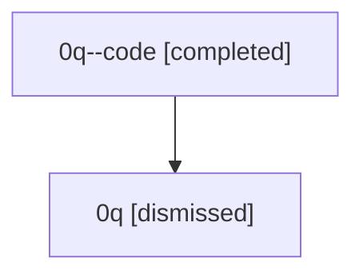

# Session: 0q

[Agent Hoods](../README.md) / [bbugyi200](../users/bbugyi200/README.md) / [athena](../users/bbugyi200/machines/athena/README.md) / [0q](../users/bbugyi200/machines/athena/hoods/0q/README.md) / 0q

Owner: `bbugyi200.athena` · Hood: `0q` · Members: 2

## Lineage

The diagram is an optional enhancement; the ordered table below contains the same lineage in accessible text.

| Role | Agent | State | Model / provider | Timing | Commits | Prompt | Chat |
|---|---|---|---|---|---:|---|---|
| code | 0q--code | completed | gpt-5.5 / codex | 2026-07-07T18:02:22.608190+00:00 | [1](../agents/bbugyi200.athena.0q--code/README.md#commits) | — | [Chat](../agents/bbugyi200.athena.0q--code/chat.md) |
| root | 0q | dismissed | gpt-5.5 / codex | 2026-07-07T13:57:32.430106 → 2026-07-07T14:21:45.037849 | [1](../agents/bbugyi200.athena.0q/README.md#commits) | [Prompt](../agents/bbugyi200.athena.0q/prompt.md) | [Chat](../agents/bbugyi200.athena.0q/chat.md) |

## Commits

| Role | Repo | Commit | Subject | Committed |
|---|---|---|---|---|
| — | — | `ca2e170` | chore: Add SDD prompt and plan for workflow\_variables | 2026-06-02 23:13:16 EDT |
| — | — | `46aa1d2` | feat: rename step metadata section to workflow variables | 2026-06-02 23:18:28 EDT |
| root | — | `84f07fe` | chore: Add SDD prompt and plan for linked\_repo\_pencil\_badge | 2026-07-07 14:02:21 EDT |
| code | — | `c962280` | feat(tui): show linked repo change badges | 2026-07-07 14:21:27 EDT |
