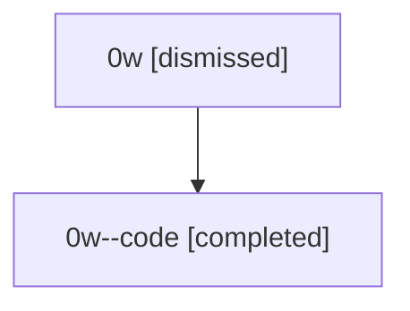

# Session: 0w

[Agent Hoods](../README.md) / [bbugyi200](../users/bbugyi200/README.md) / [athena](../users/bbugyi200/machines/athena/README.md) / [0w](../users/bbugyi200/machines/athena/hoods/0w/README.md) / 0w

Owner: `bbugyi200.athena` · Hood: `0w` · Members: 2

## Lineage

The diagram is an optional enhancement; the ordered table below contains the same lineage in accessible text.

| Role | Agent | State | Model / provider | Timing | Commits | Prompt | Chat |
|---|---|---|---|---|---:|---|---|
| root | 0w | dismissed | claude-fable-5 / claude | 2026-07-07T15:54:36.884522 → 2026-07-07T16:25:49.396944 | [1](../agents/bbugyi200.athena.0w/README.md#commits) | [Prompt](../agents/bbugyi200.athena.0w/prompt.md) | [Chat](../agents/bbugyi200.athena.0w/chat.md) |
| code | 0w--code | completed | gpt-5.5 / codex | 2026-07-07T20:04:44.815178+00:00 | [1](../agents/bbugyi200.athena.0w--code/README.md#commits) | — | [Chat](../agents/bbugyi200.athena.0w--code/chat.md) |

## Commits

| Role | Repo | Commit | Subject | Committed |
|---|---|---|---|---|
| — | — | `d3c37c5` | chore: Add SDD prompt and plan for codex\_transient\_retry | 2026-06-03 01:40:52 EDT |
| — | — | `0ceb65c` | feat: Add built-in transient-failure retry coverage for the Codex provider | 2026-06-03 02:24:56 EDT |
| root | — | `cd2be5d` | chore: Add SDD prompt and plan for gh\_ref\_tui\_credential\_freeze | 2026-07-07 16:04:43 EDT |
| code | — | `77d9330` | fix: avoid credential prompts during ref completion | 2026-07-07 16:25:09 EDT |
