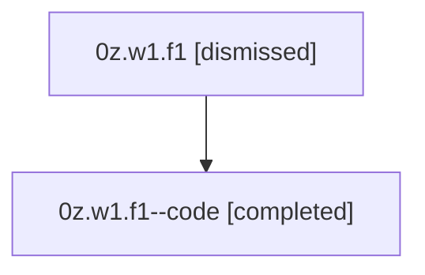

# Session: 0z.w1.f1

[Agent Hoods](../README.md) / [bbugyi200](../users/bbugyi200/README.md) / [athena](../users/bbugyi200/machines/athena/README.md) / [0z](../users/bbugyi200/machines/athena/hoods/0z/README.md) / 0z.w1.f1

Owner: `bbugyi200.athena` · Hood: `0z` · Members: 2

## Lineage

The diagram is an optional enhancement; the ordered table below contains the same lineage in accessible text.

| Role | Agent | State | Model / provider | Timing | Commits | Prompt | Chat |
|---|---|---|---|---|---:|---|---|
| root | 0z.w1.f1 | dismissed | gpt-5.5 / codex | 2026-07-07T20:36:53.359644 → 2026-07-07T20:52:09.192392 | [1](../agents/bbugyi200.athena.0z.w1.f1/README.md#commits) | [Prompt](../agents/bbugyi200.athena.0z.w1.f1/prompt.md) | [Chat](../agents/bbugyi200.athena.0z.w1.f1/chat.md) |
| code | 0z.w1.f1--code | completed | gpt-5.5 / codex | 2026-07-08T00:40:40.830423+00:00 | [1](../agents/bbugyi200.athena.0z.w1.f1--code/README.md#commits) | — | [Chat](../agents/bbugyi200.athena.0z.w1.f1--code/chat.md) |

## Commits

| Role | Repo | Commit | Subject | Committed |
|---|---|---|---|---|
| root | — | `a85b283` | chore: Add SDD prompt and plan for successful\_slow\_tool\_call\_hints | 2026-07-07 20:40:38 EDT |
| code | — | `2d13be9` | feat(tui): add slow-tool reports for successful calls | 2026-07-07 20:51:47 EDT |

## Neighbors

| Agent | Relation | State |
|---|---|---|
| [0z.w1](bbugyi200.athena.0z.w1.md) (session · 2) | ancestor | completed 1, dismissed 1 |
| [0z](bbugyi200.athena.0z.md) (session · 2) | ancestor | completed 1, dismissed 1 |
