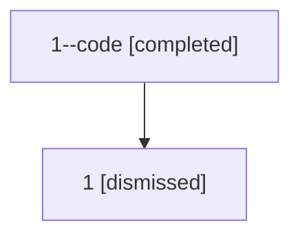

# Session: 1

[Agent Hoods](../README.md) / [bbugyi200](../users/bbugyi200/README.md) / [athena](../users/bbugyi200/machines/athena/README.md) / [1](../users/bbugyi200/machines/athena/hoods/1/README.md) / 1

Owner: `bbugyi200.athena` · Hood: `1` · Members: 2

## Lineage

The diagram is an optional enhancement; the ordered table below contains the same lineage in accessible text.

| Role | Agent | State | Model / provider | Timing | Commits | Prompt | Chat |
|---|---|---|---|---|---:|---|---|
| code | 1--code | completed | gpt-5.5 / codex | 2026-07-06T10:37:03.000748+00:00 | [1](../agents/bbugyi200.athena.1--code/README.md#commits) | — | [Chat](../agents/bbugyi200.athena.1--code/chat.md) |
| root | 1 | dismissed | claude-fable-5 / claude | 2026-07-06T06:32:48.387063 → 2026-07-06T06:48:18.499543 | [1](../agents/bbugyi200.athena.1/README.md#commits) | [Prompt](../agents/bbugyi200.athena.1/prompt.md) | [Chat](../agents/bbugyi200.athena.1/chat.md) |

## Commits

| Role | Repo | Commit | Subject | Committed |
|---|---|---|---|---|
| — | — | `f1c30a9` | chore: Add SDD prompt and plan for project\_management\_edit\_keymap\_1 | 2026-06-02 07:00:11 EDT |
| — | — | `2ed32d6` | feat: add project spec edit keymap | 2026-06-02 07:13:32 EDT |
| — | — | `8110c90` | fix: update research xprompt loader assertions | 2026-06-03 02:58:06 EDT |
| — | — | `703ed90` | chore: Add SDD prompt and plan for model\_alias\_descriptions | 2026-07-03 06:37:48 EDT |
| root | — | `a40aa0d` | chore: Add SDD prompt and plan for mode\_switch\_sync\_dev\_checkouts | 2026-07-06 06:37:01 EDT |
| code | — | `a4edccd` | fix(mode-switch): fast-forward reusable dev checkouts | 2026-07-06 06:47:57 EDT |
