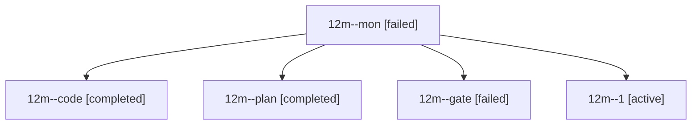

# Session: 12m

[Agent Hoods](../README.md) / [bbugyi200](../users/bbugyi200/README.md) / [athena](../users/bbugyi200/machines/athena/README.md) / [12m](../users/bbugyi200/machines/athena/hoods/12m/README.md) / 12m

Owner: `bbugyi200.athena` · Hood: `12m` · Members: 5

## Lineage

The diagram is an optional enhancement; the ordered table below contains the same lineage in accessible text.

| Role | Agent | State | Model / provider | Timing | Commits | Prompt | Chat |
|---|---|---|---|---|---:|---|---|
| mon | 12m--mon | failed | muse-spark-1.3-contributor / muse | 2026-10-20T19:43:49.470563+00:00 → 2026-10-20T20:05:26.803497+00:00 | 0 | — | [Chat](../agents/bbugyi200.athena.12m--mon/chat.md) |
| code | 12m--code | completed | muse-spark-1.3-contributor / muse | 2026-10-20T19:23:14.613092+00:00 → 2026-10-20T19:44:51.382452+00:00 | 0 | [Prompt](../agents/bbugyi200.athena.12m--code/prompt.md) | [Chat](../agents/bbugyi200.athena.12m--code/chat.md) |
| plan | 12m--plan | completed | opus / claude | 2026-10-20T18:58:56.496614+00:00 → 2026-10-20T19:10:41.142770+00:00 | 0 | [Prompt](../agents/bbugyi200.athena.12m--plan/prompt.md) | [Chat](../agents/bbugyi200.athena.12m--plan/chat.md) |
| gate | 12m--gate | failed | opus / claude | 2026-10-20T19:21:05.273671+00:00 → 2026-10-20T19:22:33.562803+00:00 | 0 | — | [Chat](../agents/bbugyi200.athena.12m--gate/chat.md) |
| 1 | 12m--1 | active | muse-spark-1.3-contributor / muse | 2026-10-20T20:08:55.961749+00:00 | [1](../agents/bbugyi200.athena.12m--1/README.md#commits) | [Prompt](../agents/bbugyi200.athena.12m--1/prompt.md) | — |

## Commits

| Role | Repo | Commit | Subject | Committed |
|---|---|---|---|---|
| 1 | sase | [`d9ff230`](https://github.com/sase-org/sase/commit/d9ff2309a73e9fdc2dcf26d7b3b54afe9268b4ba) | fix(wait): drop dead host\_completion\_reasons flat-key projection | 2026-10-20 16:16:32 EDT |
