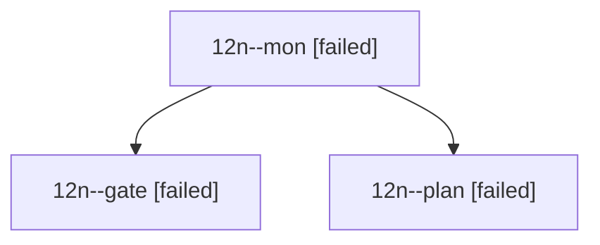

# Session: 12n

[Agent Hoods](../README.md) / [bbugyi200](../users/bbugyi200/README.md) / [athena](../users/bbugyi200/machines/athena/README.md) / [12n](../users/bbugyi200/machines/athena/hoods/12n/README.md) / 12n

Owner: `bbugyi200.athena` · Hood: `12n` · Members: 3

## Lineage

The diagram is an optional enhancement; the ordered table below contains the same lineage in accessible text.

| Role | Agent | State | Model / provider | Timing | Commits | Prompt | Chat |
|---|---|---|---|---|---:|---|---|
| mon | 12n--mon | failed | opus / claude | 2026-10-20T19:25:33.888963+00:00 → 2026-10-20T19:28:43.960772+00:00 | 0 | — | [Chat](../agents/bbugyi200.athena.12n--mon/chat.md) |
| gate | 12n--gate | failed | opus / claude | 2026-10-20T19:24:22.669917+00:00 → 2026-10-20T19:25:34.682431+00:00 | 0 | — | [Chat](../agents/bbugyi200.athena.12n--gate/chat.md) |
| plan | 12n--plan | failed | opus / claude | 2026-10-20T19:03:54.681463+00:00 → 2026-10-20T19:26:02.664862+00:00 | 0 | [Prompt](../agents/bbugyi200.athena.12n--plan/prompt.md) | [Chat](../agents/bbugyi200.athena.12n--plan/chat.md) |
