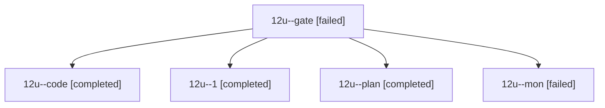

# Session: 12u

[Agent Hoods](../README.md) / [bbugyi200](../users/bbugyi200/README.md) / [athena](../users/bbugyi200/machines/athena/README.md) / [12u](../users/bbugyi200/machines/athena/hoods/12u/README.md) / 12u

Owner: `bbugyi200.athena` · Hood: `12u` · Members: 5

## Lineage

The diagram is an optional enhancement; the ordered table below contains the same lineage in accessible text.

| Role | Agent | State | Model / provider | Timing | Commits | Prompt | Chat |
|---|---|---|---|---|---:|---|---|
| gate | 12u--gate | failed | opus / claude | 2026-10-21T12:16:31.034393+00:00 → 2026-10-21T12:18:45.268341+00:00 | 0 | — | [Chat](../agents/bbugyi200.athena.12u--gate/chat.md) |
| code | 12u--code | completed | gpt-6-luna / codex | 2026-10-21T12:20:06.846725+00:00 → 2026-10-21T12:46:36.395181+00:00 | 0 | [Prompt](../agents/bbugyi200.athena.12u--code/prompt.md) | [Chat](../agents/bbugyi200.athena.12u--code/chat.md) |
| 1 | 12u--1 | completed | gpt-6-luna / codex | 2026-10-21T12:49:48.073536+00:00 → 2026-10-21T13:08:29.824261+00:00 | [1](../agents/bbugyi200.athena.12u--1/README.md#commits) | [Prompt](../agents/bbugyi200.athena.12u--1/prompt.md) | [Chat](../agents/bbugyi200.athena.12u--1/chat.md) |
| plan | 12u--plan | completed | opus / claude | 2026-10-21T12:00:53.007811+00:00 → 2026-10-21T12:11:18.043545+00:00 | 0 | [Prompt](../agents/bbugyi200.athena.12u--plan/prompt.md) | [Chat](../agents/bbugyi200.athena.12u--plan/chat.md) |
| mon | 12u--mon | failed | gpt-6-luna / codex | 2026-10-21T12:45:41.805505+00:00 → 2026-10-21T12:48:18.791860+00:00 | 0 | — | [Chat](../agents/bbugyi200.athena.12u--mon/chat.md) |

## Commits

| Role | Repo | Commit | Subject | Committed |
|---|---|---|---|---|
| 1 | sase | [`50ef6ba`](https://github.com/sase-org/sase/commit/50ef6ba498ffb054a7d8667ddaaf5d627462882f) | feat(ace): widen custom gate modal layouts | 2026-10-21 09:04:22 EDT |
