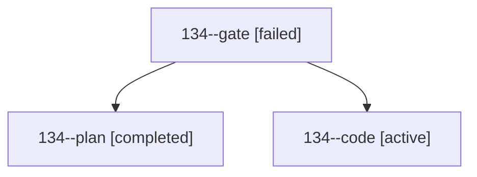

# Session: 134

[Agent Hoods](../README.md) / [bbugyi200](../users/bbugyi200/README.md) / [athena](../users/bbugyi200/machines/athena/README.md) / [134](../users/bbugyi200/machines/athena/hoods/134/README.md) / 134

Owner: `bbugyi200.athena` · Hood: `134` · Members: 3

## Lineage

The diagram is an optional enhancement; the ordered table below contains the same lineage in accessible text.

| Role | Agent | State | Model / provider | Timing | Commits | Prompt | Chat |
|---|---|---|---|---|---:|---|---|
| gate | 134--gate | failed | opus / claude | 2026-10-23T13:48:05.556586+00:00 → 2026-10-23T13:55:44.529671+00:00 | 0 | — | [Chat](../agents/bbugyi200.athena.134--gate/chat.md) |
| plan | 134--plan | completed | opus / claude | 2026-10-23T13:34:24.408340+00:00 → 2026-10-23T13:48:27.420412+00:00 | 0 | [Prompt](../agents/bbugyi200.athena.134--plan/prompt.md) | [Chat](../agents/bbugyi200.athena.134--plan/chat.md) |
| code | 134--code | active | grok-4.6 / grok | 2026-10-23T13:57:39.818826+00:00 | [1](../agents/bbugyi200.athena.134--code/README.md#commits) | [Prompt](../agents/bbugyi200.athena.134--code/prompt.md) | — |

## Commits

| Role | Repo | Commit | Subject | Committed |
|---|---|---|---|---|
| code | sase | [`35e593b`](https://github.com/sase-org/sase/commit/35e593bcc01553b14b4b5109cbc7992162c1caa6) | fix(sudo): settle oversized runner ledgers and notify on finalize failure | 2026-10-23 11:23:34 EDT |
