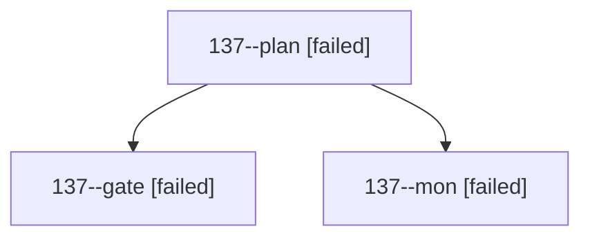

# Session: 137

[Agent Hoods](../README.md) / [bbugyi200](../users/bbugyi200/README.md) / [athena](../users/bbugyi200/machines/athena/README.md) / [137](../users/bbugyi200/machines/athena/hoods/137/README.md) / 137

Owner: `bbugyi200.athena` · Hood: `137` · Members: 3

## Lineage

The diagram is an optional enhancement; the ordered table below contains the same lineage in accessible text.

| Role | Agent | State | Model / provider | Timing | Commits | Prompt | Chat |
|---|---|---|---|---|---:|---|---|
| plan | 137--plan | failed | opus / claude | 2026-10-23T15:04:16.728798+00:00 → 2026-10-23T15:30:17.831412+00:00 | 0 | [Prompt](../agents/bbugyi200.athena.137--plan/prompt.md) | [Chat](../agents/bbugyi200.athena.137--plan/chat.md) |
| gate | 137--gate | failed | opus / claude | 2026-10-23T15:29:00.354584+00:00 → 2026-10-23T15:29:59.926095+00:00 | 0 | — | [Chat](../agents/bbugyi200.athena.137--gate/chat.md) |
| mon | 137--mon | failed | opus / claude | 2026-10-23T15:29:59.208691+00:00 → 2026-10-23T15:34:00.660254+00:00 | 0 | — | [Chat](../agents/bbugyi200.athena.137--mon/chat.md) |
