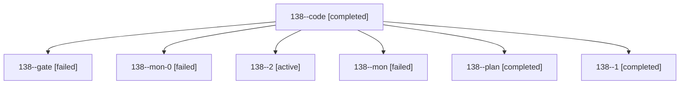

# Session: 138

[Agent Hoods](../README.md) / [bbugyi200](../users/bbugyi200/README.md) / [athena](../users/bbugyi200/machines/athena/README.md) / [138](../users/bbugyi200/machines/athena/hoods/138/README.md) / 138

Owner: `bbugyi200.athena` · Hood: `138` · Members: 7

## Lineage

The diagram is an optional enhancement; the ordered table below contains the same lineage in accessible text.

| Role | Agent | State | Model / provider | Timing | Commits | Prompt | Chat |
|---|---|---|---|---|---:|---|---|
| code | 138--code | completed | gpt-6-luna / codex | 2026-10-23T16:18:50.793944+00:00 → 2026-10-23T16:29:02.935481+00:00 | 0 | [Prompt](../agents/bbugyi200.athena.138--code/prompt.md) | [Chat](../agents/bbugyi200.athena.138--code/chat.md) |
| gate | 138--gate | failed | opus / claude | 2026-10-23T16:14:30.447242+00:00 → 2026-10-23T16:17:36.299368+00:00 | 0 | — | [Chat](../agents/bbugyi200.athena.138--gate/chat.md) |
| mon-0 | 138--mon-0 | failed | gpt-6-luna / codex | 2026-10-23T17:33:31.404077+00:00 → 2026-10-23T17:48:11.695740+00:00 | [1](../agents/bbugyi200.athena.138--mon-0/README.md#commits) | — | [Chat](../agents/bbugyi200.athena.138--mon-0/chat.md) |
| 2 | 138--2 | active | gpt-6-luna / codex | 2026-10-23T17:52:15.192437+00:00 | 0 | [Prompt](../agents/bbugyi200.athena.138--2/prompt.md) | — |
| mon | 138--mon | failed | gpt-6-luna / codex | 2026-10-23T16:28:16.000655+00:00 → 2026-10-23T17:11:46.597448+00:00 | 0 | — | [Chat](../agents/bbugyi200.athena.138--mon/chat.md) |
| plan | 138--plan | completed | opus / claude | 2026-10-23T15:59:27.086352+00:00 → 2026-10-23T16:08:41.968526+00:00 | 0 | [Prompt](../agents/bbugyi200.athena.138--plan/prompt.md) | [Chat](../agents/bbugyi200.athena.138--plan/chat.md) |
| 1 | 138--1 | completed | gpt-6-luna / codex | 2026-10-23T17:13:28.158969+00:00 → 2026-10-23T17:34:34.366376+00:00 | 0 | [Prompt](../agents/bbugyi200.athena.138--1/prompt.md) | [Chat](../agents/bbugyi200.athena.138--1/chat.md) |

## Commits

| Role | Repo | Commit | Subject | Committed |
|---|---|---|---|---|
| mon-0 | sase | [`fc0b414`](https://github.com/sase-org/sase/commit/fc0b41479fad7fef278e348a084eb46da04ea9d8) | fix(sudo): defer settlement after lock contention | 2026-10-23 13:45:33 EDT |
