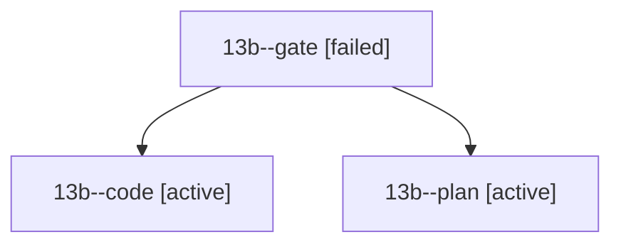

# Session: 13b

[Agent Hoods](../README.md) / [bbugyi200](../users/bbugyi200/README.md) / [athena](../users/bbugyi200/machines/athena/README.md) / [13b](../users/bbugyi200/machines/athena/hoods/13b/README.md) / 13b

Owner: `bbugyi200.athena` · Hood: `13b` · Members: 3

## Lineage

The diagram is an optional enhancement; the ordered table below contains the same lineage in accessible text.

| Role | Agent | State | Model / provider | Timing | Commits | Prompt | Chat |
|---|---|---|---|---|---:|---|---|
| gate | 13b--gate | failed | opus / claude | 2026-10-24T02:31:46.626616+00:00 → 2026-10-24T02:32:17.256094+00:00 | 0 | — | [Chat](../agents/bbugyi200.athena.13b--gate/chat.md) |
| code | 13b--code | active | gpt-6-luna / codex | 2026-10-24T02:32:57.135969+00:00 | 0 | — | — |
| plan | 13b--plan | active | opus / claude | 2026-10-24T02:19:00.387018+00:00 | 0 | [Prompt](../agents/bbugyi200.athena.13b--plan/prompt.md) | [Chat](../agents/bbugyi200.athena.13b--plan/chat.md) |
