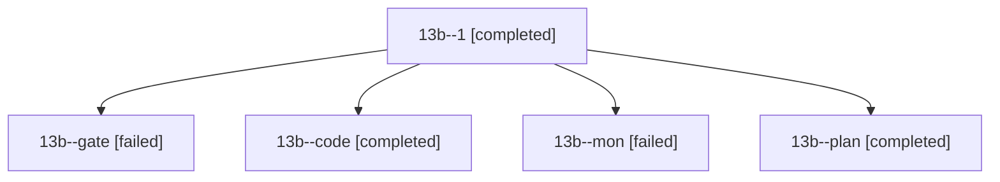

# Session: 13b

[Agent Hoods](../README.md) / [bbugyi200](../users/bbugyi200/README.md) / [athena](../users/bbugyi200/machines/athena/README.md) / [13b](../users/bbugyi200/machines/athena/hoods/13b/README.md) / 13b

Owner: `bbugyi200.athena` · Hood: `13b` · Members: 5

## Lineage

The diagram is an optional enhancement; the ordered table below contains the same lineage in accessible text.

| Role | Agent | State | Model / provider | Timing | Commits | Prompt | Chat |
|---|---|---|---|---|---:|---|---|
| 1 | 13b--1 | completed | gpt-6-luna / codex | 2026-10-24T02:49:45.697291+00:00 → 2026-10-24T03:26:29.092746+00:00 | [1](../agents/bbugyi200.athena.13b--1/README.md#commits) | [Prompt](../agents/bbugyi200.athena.13b--1/prompt.md) | [Chat](../agents/bbugyi200.athena.13b--1/chat.md) |
| gate | 13b--gate | failed | opus / claude | 2026-10-24T02:31:46.626616+00:00 → 2026-10-24T02:32:17.256094+00:00 | 0 | — | [Chat](../agents/bbugyi200.athena.13b--gate/chat.md) |
| code | 13b--code | completed | gpt-6-luna / codex | 2026-10-24T02:32:57.135969+00:00 → 2026-10-24T02:47:06.125937+00:00 | 0 | — | [Chat](../agents/bbugyi200.athena.13b--code/chat.md) |
| mon | 13b--mon | failed | gpt-6-luna / codex | 2026-10-24T02:46:29.039337+00:00 → 2026-10-24T02:48:55.144167+00:00 | 0 | — | [Chat](../agents/bbugyi200.athena.13b--mon/chat.md) |
| plan | 13b--plan | completed | opus / claude | 2026-10-24T02:19:00.387018+00:00 → 2026-10-24T02:47:06.125937+00:00 | 0 | [Prompt](../agents/bbugyi200.athena.13b--plan/prompt.md) | [Chat](../agents/bbugyi200.athena.13b--plan/chat.md) |

## Commits

| Role | Repo | Commit | Subject | Committed |
|---|---|---|---|---|
| 1 | sase | [`102c6ee`](https://github.com/sase-org/sase/commit/102c6ee847215d0e813532329fb8af48a0ad29b7) | feat(stats): add repo breakdowns to project reports | 2026-10-23 23:24:28 EDT |
