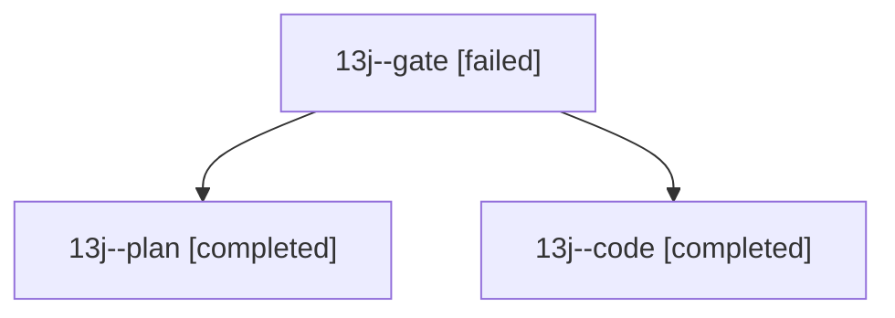

# Session: 13j

[Agent Hoods](../README.md) / [bbugyi200](../users/bbugyi200/README.md) / [athena](../users/bbugyi200/machines/athena/README.md) / [13j](../users/bbugyi200/machines/athena/hoods/13j/README.md) / 13j

Owner: `bbugyi200.athena` · Hood: `13j` · Members: 3

## Lineage

The diagram is an optional enhancement; the ordered table below contains the same lineage in accessible text.

| Role | Agent | State | Model / provider | Timing | Commits | Prompt | Chat |
|---|---|---|---|---|---:|---|---|
| gate | 13j--gate | failed | opus / claude | 2026-10-24T09:40:29.832118+00:00 → 2026-10-24T09:41:49.772694+00:00 | 0 | — | [Chat](../agents/bbugyi200.athena.13j--gate/chat.md) |
| plan | 13j--plan | completed | opus / claude | 2026-10-24T09:30:36.251148+00:00 → 2026-10-24T09:40:50.036684+00:00 | 0 | [Prompt](../agents/bbugyi200.athena.13j--plan/prompt.md) | [Chat](../agents/bbugyi200.athena.13j--plan/chat.md) |
| code | 13j--code | completed | grok-4.6 / grok | 2026-10-24T09:43:26.930105+00:00 → 2026-10-24T10:44:29.016248+00:00 | 0 | [Prompt](../agents/bbugyi200.athena.13j--code/prompt.md) | [Chat](../agents/bbugyi200.athena.13j--code/chat.md) |
