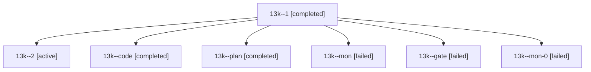

# Session: 13k

[Agent Hoods](../README.md) / [bbugyi200](../users/bbugyi200/README.md) / [athena](../users/bbugyi200/machines/athena/README.md) / [13k](../users/bbugyi200/machines/athena/hoods/13k/README.md) / 13k

Owner: `bbugyi200.athena` · Hood: `13k` · Members: 7

## Lineage

The diagram is an optional enhancement; the ordered table below contains the same lineage in accessible text.

| Role | Agent | State | Model / provider | Timing | Commits | Prompt | Chat |
|---|---|---|---|---|---:|---|---|
| 1 | 13k--1 | completed | gpt-6-luna / codex | 2026-10-24T12:08:28.564385+00:00 → 2026-10-24T12:25:47.790462+00:00 | 0 | [Prompt](../agents/bbugyi200.athena.13k--1/prompt.md) | [Chat](../agents/bbugyi200.athena.13k--1/chat.md) |
| 2 | 13k--2 | active | gpt-6-luna / codex | 2026-10-24T12:51:08.623833+00:00 | [1](../agents/bbugyi200.athena.13k--2/README.md#commits) | [Prompt](../agents/bbugyi200.athena.13k--2/prompt.md) | — |
| code | 13k--code | completed | gpt-6-luna / codex | 2026-10-24T10:11:44.640102+00:00 → 2026-10-24T11:07:27.307957+00:00 | 0 | [Prompt](../agents/bbugyi200.athena.13k--code/prompt.md) | [Chat](../agents/bbugyi200.athena.13k--code/chat.md) |
| plan | 13k--plan | completed | opus / claude | 2026-10-24T09:55:19.810340+00:00 → 2026-10-24T10:05:41.497945+00:00 | 0 | [Prompt](../agents/bbugyi200.athena.13k--plan/prompt.md) | [Chat](../agents/bbugyi200.athena.13k--plan/chat.md) |
| mon | 13k--mon | failed | gpt-6-luna / codex | 2026-10-24T11:06:09.292031+00:00 → 2026-10-24T11:41:24.309390+00:00 | 0 | — | [Chat](../agents/bbugyi200.athena.13k--mon/chat.md) |
| gate | 13k--gate | failed | opus / claude | 2026-10-24T10:04:46.834121+00:00 → 2026-10-24T10:08:23.145812+00:00 | 0 | — | [Chat](../agents/bbugyi200.athena.13k--gate/chat.md) |
| mon-0 | 13k--mon-0 | failed | gpt-6-luna / codex | 2026-10-24T12:20:10.445417+00:00 → 2026-10-24T12:49:14.947818+00:00 | 0 | — | [Chat](../agents/bbugyi200.athena.13k--mon-0/chat.md) |

## Commits

| Role | Repo | Commit | Subject | Committed |
|---|---|---|---|---|
| 2 | sase | [`79fa96d`](https://github.com/sase-org/sase/commit/79fa96dfc7d5c5f18f2a0472c01657eddde2d85e) | feat(ace): gate Artifacts Files pane behind a beta flag | 2026-10-24 10:46:39 EDT |
